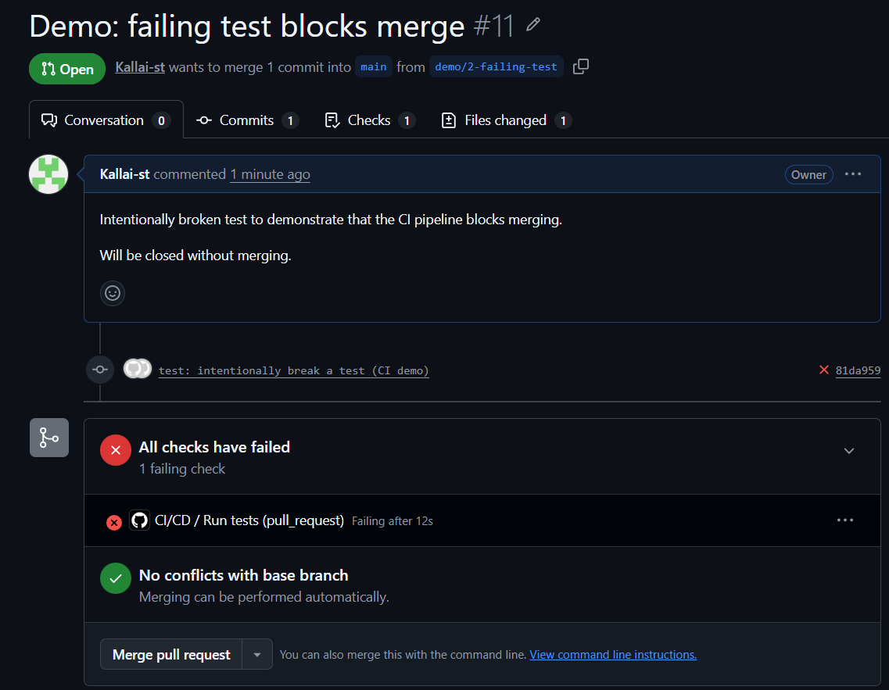
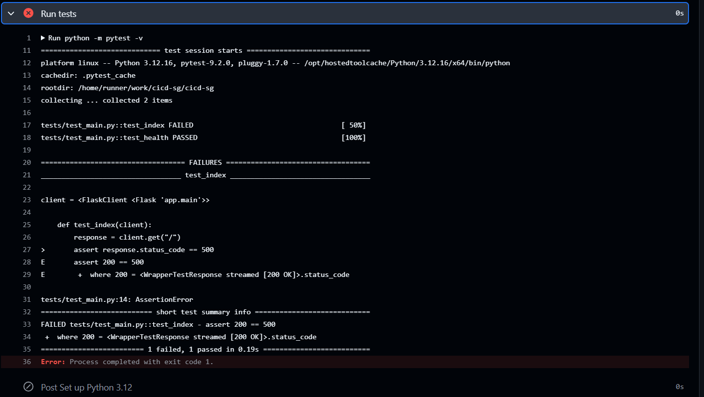

# 02 – Continuous Integration: Automated Tests

## Goal

Run the test suite automatically on every change, so that broken code cannot reach the `main` branch.

## Workflow file

`.github/workflows/ci-cd.yml`

## Triggers

| Event | When |
|---|---|
| `pull_request` | A PR targeting `main` is opened or updated |
| `push` | A commit lands on `main` (e.g. after a merge) |
| `workflow_dispatch` | Manual run from the Actions tab |

## The `test` job

Runs on a fresh `ubuntu-latest` runner:

1. **Check out repository** – `actions/checkout`
2. **Set up Python 3.12** – `actions/setup-python`, with pip caching keyed on the requirements files
3. **Install dependencies** – `pip install -r requirements-dev.txt` (includes runtime deps + pytest)
4. **Run tests** – `python -m pytest -v`

If any test fails, pytest exits with a non-zero code, the job fails, and later jobs (build, scan, push, deploy) will not run.

## Security considerations

- The workflow uses `permissions: contents: read` (least privilege). Jobs that need more (e.g. pushing to GHCR) will request it explicitly.
- Only official, widely used actions are used.

## Branch protection

`main` is protected: changes must go through a pull request, and the `Run tests` status check must pass before merging.

## Running tests locally

```powershell
.venv\Scripts\Activate.ps1
python -m pytest -v
```

## Demonstration: a failing test blocks the merge

To verify the pipeline, a test was intentionally broken on a separate branch (`demo/2-failing-test`) and a pull request was opened. The `Run tests` check failed, and branch protection prevented the merge. The PR was closed without merging.

**Failed check on the pull request – merging is blocked:**



**The test log shows which assertion failed:**

