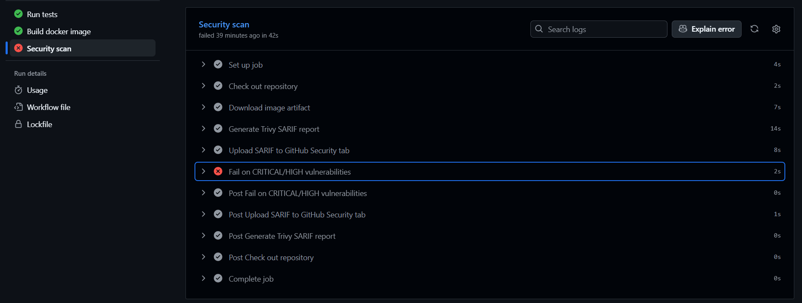
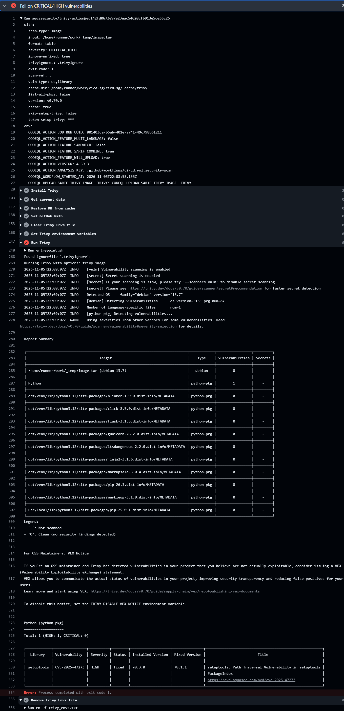
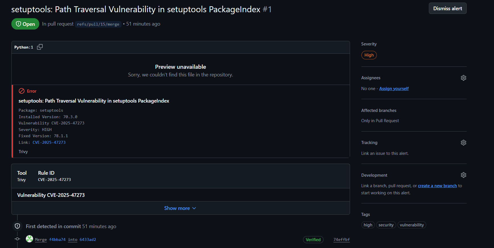
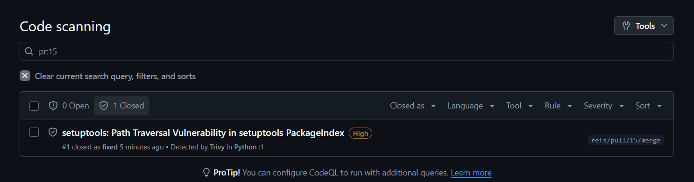

# 04 – Security Scan with Trivy

This document describes how the CI/CD pipeline scans the Docker image for known vulnerabilities and blocks images that do not meet the security requirements.

Related issue: #4

## Overview

After the image is built and smoke-tested, a dedicated `security-scan` job scans it with [Trivy](https://trivy.dev/). The pipeline order is:

```
test → build → security-scan → (push → deploy)
```

The job fails – and therefore stops the pipeline – if the image contains any **CRITICAL** or **HIGH** severity vulnerability for which a fix is available. The results are also uploaded to the repository's **Security → Code scanning** page in SARIF format.

## Pass/fail criteria

| Setting | Value | Reason |
|---|---|---|
| `severity` | `CRITICAL,HIGH` | Only serious vulnerabilities block the pipeline. |
| `ignore-unfixed` | `true` | Vulnerabilities without an available fix are not actionable, so they do not block the pipeline. Without this, the Debian-based `slim` image would almost always contain an unfixed HIGH CVE. |
| `exit-code` | `1` (gate step) | A non-zero exit code makes the job fail. |
| `trivyignores` | `.trivyignore` | Explicitly accepted vulnerabilities (see below). |

## How the image gets to the scan job

Jobs in GitHub Actions run on separate runners, so the image built in the `build` job is not available in the `security-scan` job by default. It is handed over as a workflow artifact:

1. **build job:** after the smoke test passes, the image is exported with `docker save` and uploaded with `actions/upload-artifact` (`retention-days: 1`).
2. **security-scan job:** the tarball is downloaded with `actions/download-artifact`, and Trivy scans it directly via the `input:` parameter. No `docker load` is needed.

This guarantees that the scanned image is exactly the one that was built and tested. Only images that passed the smoke test are scanned.

## The security-scan job

```yaml
  security-scan:
    name: Security scan
    runs-on: ubuntu-24.04
    needs: build
    permissions:
      contents: read
      security-events: write
    steps:
      - name: Check out repository
        uses: actions/checkout@v5

      - name: Download image artifact
        uses: actions/download-artifact@v8
        with:
          name: docker-image
          path: ${{ runner.temp }}

      - name: Generate Trivy SARIF report
        uses: aquasecurity/trivy-action@ed142fd0673e97e23eac54620cfb913e5ce36c25 # v0.36.0
        with:
          scan-type: image
          input: ${{ runner.temp }}/image.tar
          format: sarif
          output: trivy-results.sarif
          severity: CRITICAL,HIGH
          limit-severities-for-sarif: true
          ignore-unfixed: true
          trivyignores: .trivyignore
          exit-code: '0'

      - name: Upload SARIF to GitHub Security tab
        if: always() && hashFiles('trivy-results.sarif') != ''
        uses: github/codeql-action/upload-sarif@v4
        with:
          sarif_file: trivy-results.sarif
          category: trivy-image

      - name: Fail on CRITICAL/HIGH vulnerabilities
        uses: aquasecurity/trivy-action@ed142fd0673e97e23eac54620cfb913e5ce36c25 # v0.36.0
        with:
          scan-type: image
          input: ${{ runner.temp }}/image.tar
          format: table
          severity: CRITICAL,HIGH
          ignore-unfixed: true
          trivyignores: .trivyignore
          exit-code: '1'
```

Key design decisions:

- **Two Trivy steps.** The first one only generates the SARIF report and never fails (`exit-code: '0'`). The second one is the actual gate. This order makes sure the report is uploaded to the Security tab even when the gate fails.
- **`limit-severities-for-sarif: true`.** Without it, the SARIF report would contain all severities regardless of the `severity` filter.
- **Least privilege.** The workflow-level permission is `contents: read`. Only the `security-scan` job gets `security-events: write`, which is required for the SARIF upload.

## Supply chain security: pinning the Trivy action to a commit SHA

The Trivy action is referenced by its full commit SHA instead of a version tag:

```yaml
uses: aquasecurity/trivy-action@ed142fd0673e97e23eac54620cfb913e5ce36c25 # v0.36.0
```

**Why:** in March 2026 the Trivy ecosystem was hit by a supply chain attack (CVE-2026-33634). Attackers used compromised credentials to force-push 76 of the 77 version tags of `aquasecurity/trivy-action` to a credential-stealing payload. Any workflow that referenced the action by a tag ran malicious code, with access to the workflow's secrets.

Git tags can be moved; a commit SHA cannot. Pinning to a SHA guarantees that the exact, reviewed code runs every time. The trailing `# v0.36.0` comment keeps the version readable for humans. To upgrade, look up the SHA of the new release on the [releases page](https://github.com/aquasecurity/trivy-action/releases) and replace both the SHA and the comment.

## Accepting a vulnerability: `.trivyignore`

If a vulnerability cannot be fixed, or is proven not exploitable in this application, it can be accepted by adding its ID to `.trivyignore`. Rules:

- One CVE ID per line.
- Every entry must have a justification comment on the line above it.
- If a fix is available, fix it instead of ignoring it.

```
# Not exploitable: the affected feature is not used by the app.
# CVE-2024-12345
```

## Real finding: CVE-2025-47273 (setuptools)

The very first run of the scan job found a real vulnerability and stopped the pipeline – a good demonstration that the gate works.

**Finding:** `setuptools` 70.3.0, CVE-2025-47273 (path traversal in `PackageIndex`), severity HIGH, fixed in 78.1.1.

**Investigation:** the OS packages (Debian 13) were clean, and no `setuptools` package was installed either in the application's virtual environment (`/opt/venv`) or in the system Python. The finding came from the **system pip** of the `python:3.12-slim` base image (pip 25.0.1 in `/usr/local/lib/python3.12/site-packages`). pip vendors parts of setuptools (`pkg_resources`) and lists the vendored versions in `pip/_vendor/vendor.txt`, which is where Trivy detected `setuptools==70.3.0`.

Useful commands for the investigation (run as root, because the container runs as the non-root `appuser` by default):

```powershell
docker run --rm --user root --entrypoint find cicd-sg:local / -name "setuptools*" -not -path "/proc/*"
docker run --rm --user root --entrypoint cat cicd-sg:local /usr/local/lib/python3.12/site-packages/pip/_vendor/vendor.txt
```

**Fix:** the application runs from `/opt/venv`, which has its own up-to-date pip. The system pip is not used at runtime (the HEALTHCHECK uses plain Python), so it was removed from the final image:

```dockerfile
RUN python -m pip uninstall -y pip
```

This also makes the image smaller and reduces the attack surface. Strictly speaking, the vulnerable `PackageIndex` code is not part of pip's vendored copy, so the finding was most likely not exploitable – but since a one-line fix was available, fixing it was preferred over adding it to `.trivyignore`.

After the fix, the scan passed, and the code scanning alert was closed automatically as **Fixed**.

### Screenshots

1. The failing pull request – merging is blocked by the failed `Security scan` check:
   
2. The Trivy log of the gate step listing the vulnerability:
   
3. The code scanning alert on the Security tab:
   
4. The alert closed as Fixed after the remediation:
   

## Viewing scan results on GitHub

- **Security → Code scanning** shows alerts for the `main` branch by default (filter: `branch:main`).
- Alerts from a pull request belong to the PR's merge ref (`refs/pull/<N>/merge`), not to the feature branch. Use the filter `pr:<N>` to see them.
- The PR's **Checks** tab shows a *Code scanning results / Trivy* check. It may say "No new alerts in code changed by this pull request", because image findings point to files inside the image, not to files in the repository diff.
- Do not use **Dismiss alert** for findings that should be fixed – a fixed alert closes automatically after the next clean scan.

## Branch protection

The `Security scan` check was added to the required status checks of the `main` ruleset (Settings → Rules → Rulesets). A pull request can only be merged if `Run tests`, `Build docker image` and `Security scan` all pass.
