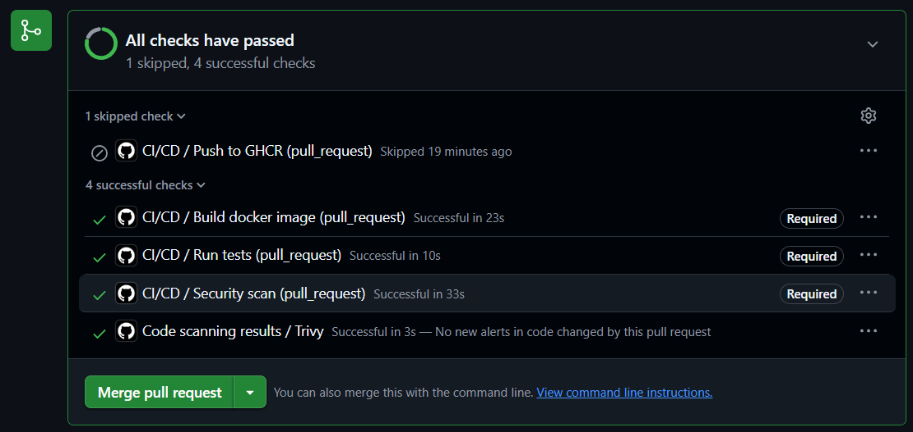
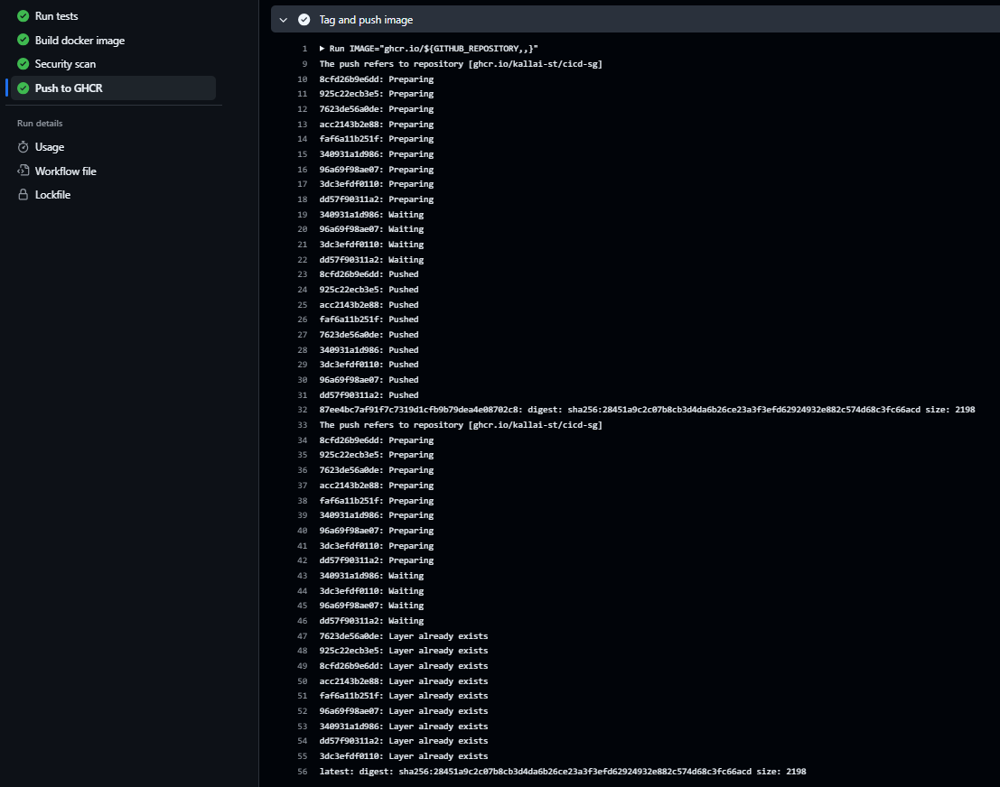
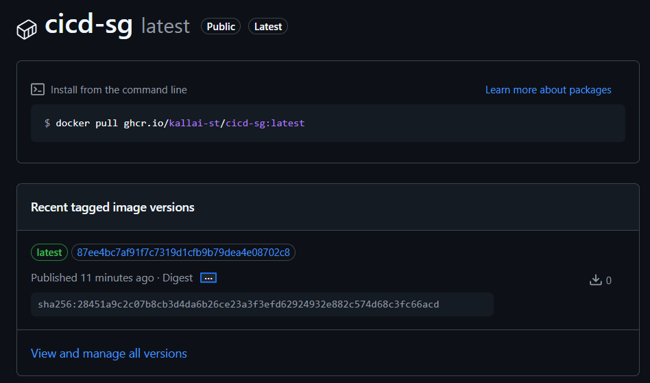
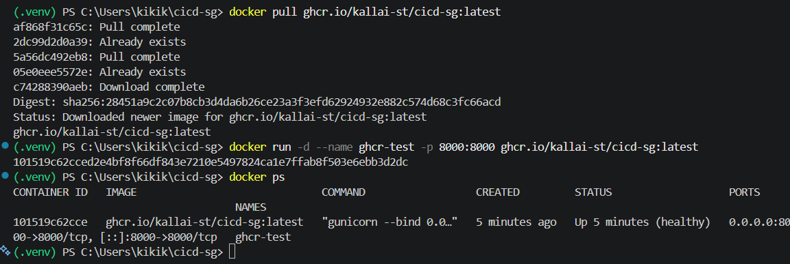

# 05 – Push Image to GHCR

## Overview

After the image has passed the tests, the build smoke test and the Trivy security scan, the pipeline publishes it to the GitHub Container Registry (GHCR). The new `push-image` job (`Push to GHCR`) is the fourth link in the chain:

```
test → build → security-scan → push-image
```

The image is published as:

```
ghcr.io/kallai-st/cicd-sg:<commit SHA>
ghcr.io/kallai-st/cicd-sg:latest
```

## When the push runs

The job only runs when both conditions are true:

- **The security scan succeeded** – `needs: security-scan`. If Trivy finds a HIGH or CRITICAL vulnerability, the scan job fails and the push job never starts.
- **The run is on `main` and is not a pull request**:

  ```yaml
  if: github.event_name != 'pull_request' && github.ref == 'refs/heads/main'
  ```

  On pull requests the job shows up as **Skipped**. A manual `workflow_dispatch` run from another branch is skipped as well.

| Event | test | build | security-scan | push-image |
|---|---|---|---|---|
| Pull request to `main` | ✅ | ✅ | ✅ | ⏭️ skipped |
| Push / merge to `main` | ✅ | ✅ | ✅ | ✅ |

## Pushing exactly the scanned image

The push job does **not** rebuild the image. It downloads the `docker-image` artifact created by the build job (the same tarball the security scan checked), loads it with `docker load`, then tags and pushes it. This guarantees that the image in the registry is byte-for-byte the image that passed the scan.

## Authentication and permissions

The job logs in with the built-in `GITHUB_TOKEN`, so no personal access token or extra secret is needed:

```yaml
- name: Log in to GHCR
  uses: docker/login-action@v4
  with:
    registry: ghcr.io
    username: ${{ github.actor }}
    password: ${{ secrets.GITHUB_TOKEN }}
```

The workflow keeps `permissions: contents: read` as the default. Only the push job is granted `packages: write`, following the principle of least privilege.

## Image name and tags

GHCR only accepts lowercase image names, but the repository owner is `Kallai-st` (uppercase `K`). The job lowercases the repository name with bash parameter expansion (`${VAR,,}`):

```bash
IMAGE="ghcr.io/${GITHUB_REPOSITORY,,}"   # → ghcr.io/kallai-st/cicd-sg
```

Two tags are pushed:

- **Commit SHA** – immutable; identifies exactly which commit the image was built from and allows rollback to any earlier version.
- **`latest`** – always points to the newest image from `main`; convenient for deployment.

Both tags point to the same image digest. When `latest` is pushed after the SHA tag, every layer reports `Layer already exists`, so nothing is uploaded twice.

## The push-image job

```yaml
push-image:
  name: Push to GHCR
  runs-on: ubuntu-24.04
  needs: security-scan
  if: github.event_name != 'pull_request' && github.ref == 'refs/heads/main'
  permissions:
    contents: read
    packages: write
  steps:
    - name: Download image artifact
      uses: actions/download-artifact@v8
      with:
        name: docker-image
        path: ${{ runner.temp }}

    - name: Load image
      run: docker load --input "${{ runner.temp }}/image.tar"

    - name: Log in to GHCR
      uses: docker/login-action@v4
      with:
        registry: ghcr.io
        username: ${{ github.actor }}
        password: ${{ secrets.GITHUB_TOKEN }}

    - name: Tag and push image
      run: |
        IMAGE="ghcr.io/${GITHUB_REPOSITORY,,}"
        docker tag "cicd-sg:${GITHUB_SHA}" "${IMAGE}:${GITHUB_SHA}"
        docker tag "cicd-sg:${GITHUB_SHA}" "${IMAGE}:latest"
        docker push "${IMAGE}:${GITHUB_SHA}"
        docker push "${IMAGE}:latest"
        echo "Pushed \`${IMAGE}:${GITHUB_SHA}\` and \`${IMAGE}:latest\`" >> "$GITHUB_STEP_SUMMARY"
```

## Linking the package to the repository

The build job adds a standard OCI label to the image:

```yaml
labels: |
  org.opencontainers.image.source=${{ github.server_url }}/${{ github.repository }}
```

GHCR uses this label to connect the package to the repository, so it appears under **Packages** in the repository sidebar.

## Package visibility

The package is **public**, so anyone (including the deployment target in issue #6) can pull it without logging in:

```bash
docker pull ghcr.io/kallai-st/cicd-sg:latest
```

Visibility can be changed on the package page under **Package settings → Danger Zone → Change visibility**.

## Verification

### Pull request: push is skipped

[](https://github.com/Kallai-st/cicd-sg/blob/main/docs/images/05-pr-checks.png)

### Main: the full chain runs and the image is pushed

The log of the `Tag and push image` step shows both pushes with the same digest:

[](https://github.com/Kallai-st/cicd-sg/blob/main/docs/images/05-push-log.png)

### The package on GHCR

Both tags (`latest` and the commit SHA) belong to the same version:

[](https://github.com/Kallai-st/cicd-sg/blob/main/docs/images/05-package.png)

### Pulling and running the published image locally

```powershell
docker pull ghcr.io/kallai-st/cicd-sg:latest
docker run -d --name ghcr-test -p 8000:8000 ghcr.io/kallai-st/cicd-sg:latest
docker ps          # STATUS shows (healthy)
docker rm -f ghcr-test
```

[](https://github.com/Kallai-st/cicd-sg/blob/main/docs/images/05-docker-pull.png)

## Branch protection

`Push to GHCR` is intentionally **not** a required status check in the `main` ruleset. It never runs on pull requests, so there is nothing for it to report before merging. The required checks remain `Run tests`, `Build docker image` and `Security scan`.

