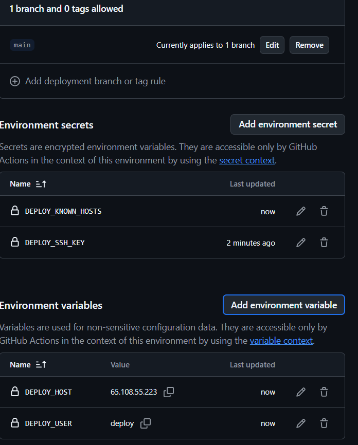
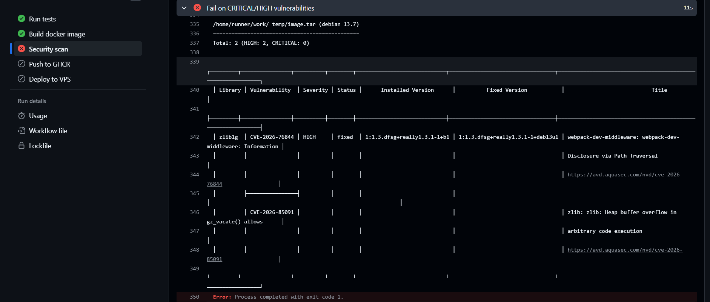
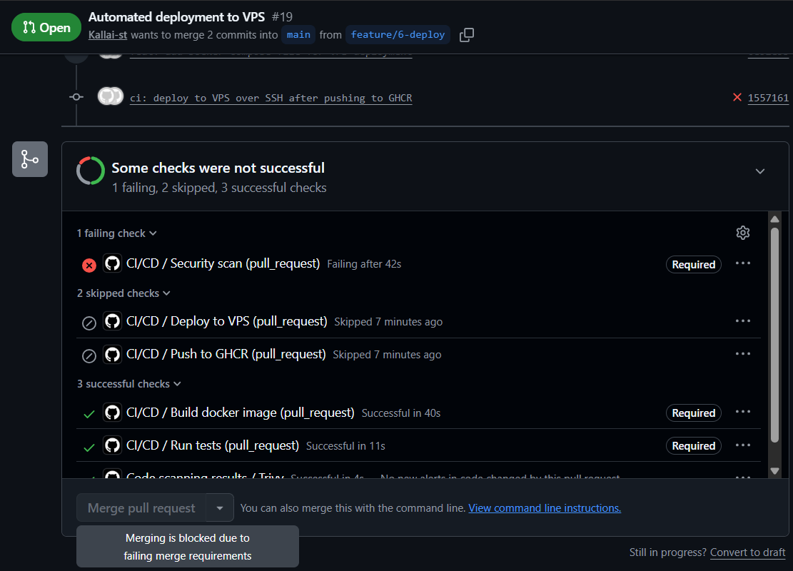
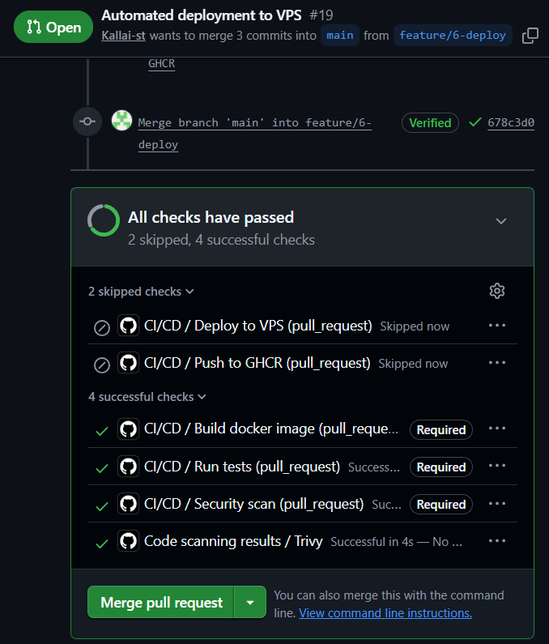
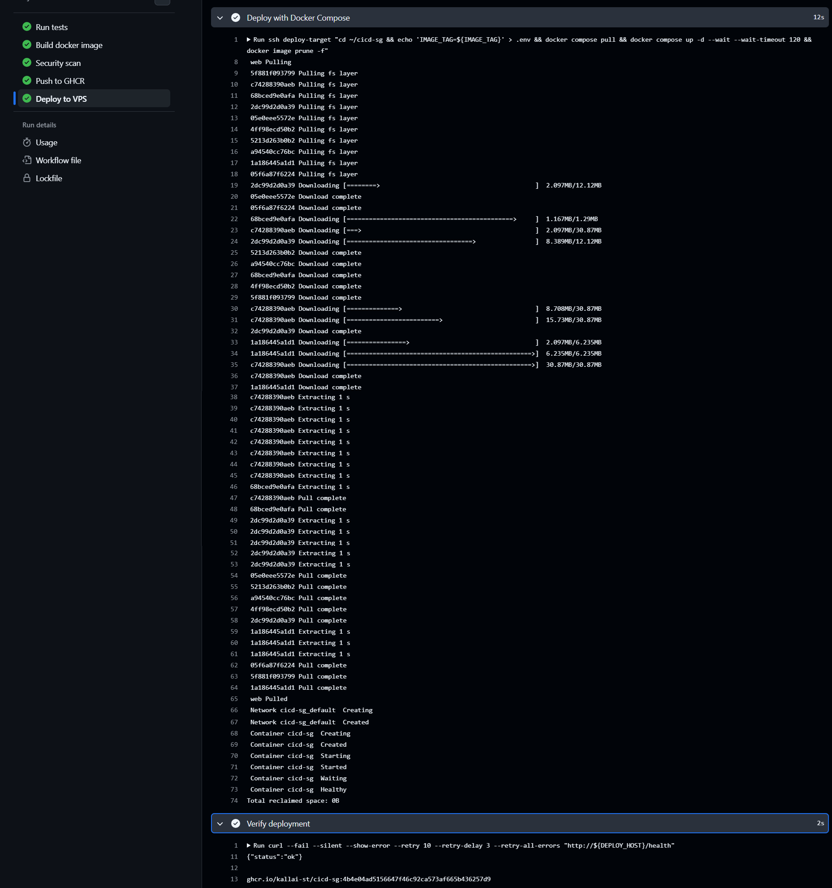
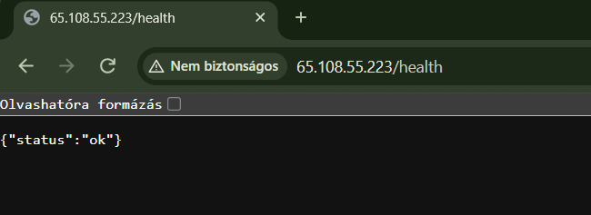

# 06 – Automated Deployment to a VPS

## Overview

The last stage of the pipeline deploys the scanned image to a virtual private server (VPS). After every merge to `main`, once the image has passed the security scan and been pushed to GHCR, the `deploy` job connects to the server over SSH, pulls the exact image that was just pushed, starts it with Docker Compose and checks from the outside that it is healthy.

```
test → build → security-scan → push-image → deploy
```

On pull requests, `push-image` and `deploy` are skipped, so nothing from an unmerged branch ever reaches the registry or the server.

## Target environment

| Item | Value | Reason |
|---|---|---|
| Provider | Hetzner Cloud (Helsinki) | Low cost, hourly billing, EU data centre |
| Server type | 1 vCPU (AMD, x86), 1 GB RAM, 20 GB SSD | Enough for the app; must be x86 because the image is built for `linux/amd64` |
| OS | Ubuntu 24.04 LTS | Mature LTS release, supported until 2029 |
| Container runtime | `docker.io` + `docker-compose-v2` (Ubuntu packages) | Simple installation from the distribution |
| Swap | 1 GB (`/swapfile`) | Safety margin for a 1 GB machine |
| Firewall | Hetzner Cloud Firewall: inbound TCP 22 (SSH) and 80 (HTTP) only | SSH must stay open because GitHub-hosted runners use changing IP addresses |
| Public IPv4 | Enabled | GitHub-hosted runners only reach the server over IPv4 |

## Server hardening

- **Key-only SSH:** password login is disabled and root can only log in with a key (`/etc/ssh/sshd_config.d/01-hardening.conf`):
  ```
  PasswordAuthentication no
  PermitRootLogin prohibit-password
  ```
  The `01-` prefix matters: sshd uses the first value it reads, so this file has to be read before the provider's own config files.
- **Dedicated `deploy` user:** created with `adduser --disabled-password`, so it has no password and can only log in with its SSH key. It is a member of the `docker` group so it can run containers without `sudo`.
- **Separate CI key:** the pipeline uses its own ED25519 key pair (`github-actions-deploy`), which is only authorised for the `deploy` user on this server. The administrator uses a different key for `root`.

> **Known trade-off:** membership in the `docker` group is effectively root-equivalent on the host. This is accepted for this project and limited by giving the key to CI only, restricting it to this single server, and storing it in a branch-restricted environment (see below).

## Secrets and the `production` environment

All deployment data lives in a GitHub **environment** called `production` (Settings → Environments), not in the repository.

| Name | Kind | Content |
|---|---|---|
| `DEPLOY_SSH_KEY` | Secret | Private key of the CI key pair |
| `DEPLOY_KNOWN_HOSTS` | Secret | The server's ED25519 host key (`<host> ssh-ed25519 AAAA...`) |
| `DEPLOY_HOST` | Variable | Public IPv4 address of the server |
| `DEPLOY_USER` | Variable | `deploy` |

- **Deployment branches** are limited to `main`: jobs running on any other branch or on a pull request cannot read these secrets.
- The host key was read directly from the server (`/etc/ssh/ssh_host_ed25519_key.pub`) over an already trusted SSH session, not with `ssh-keyscan` from an unknown network.
- The host and user are stored as variables, not secrets, because they are not confidential. This keeps them readable in the logs and lets the job show a clickable deployment URL.

## The Compose file

`deploy/docker-compose.yml` describes how the container runs on the server:

```yaml
services:
  web:
    image: ghcr.io/kallai-st/cicd-sg:${IMAGE_TAG:-latest}
    container_name: cicd-sg
    ports:
      - "80:8000"
    restart: unless-stopped
    read_only: true
    tmpfs:
      - /tmp
    cap_drop:
      - ALL
    security_opt:
      - no-new-privileges:true
    mem_limit: 256m
    logging:
      driver: json-file
      options:
        max-size: "10m"
        max-file: "3"
```

- **`${IMAGE_TAG:-latest}`**: the pipeline sets the exact commit SHA. `latest` is only a fallback.
- **`ports: "80:8000"`**: plain HTTP on port 80 is forwarded to Gunicorn on port 8000 inside the container.
- **`restart: unless-stopped`**: the container comes back after a crash or a server reboot.
- **`read_only` + `tmpfs: /tmp`**: the container filesystem is read-only, except an in-memory `/tmp` that Gunicorn needs. An attacker who compromised the app could not modify its files.
- **`cap_drop: ALL` + `no-new-privileges`**: all Linux capabilities are removed and the process cannot gain new privileges at runtime. Together with the non-root `appuser` from the Dockerfile, this keeps the container's privileges to a minimum.
- **`mem_limit: 256m`**: the app cannot exhaust the memory of the 1 GB server.
- **Log rotation**: at most 3 × 10 MB of logs, so the disk cannot fill up.

The hardened configuration was tested locally before deployment:

```powershell
docker compose -f deploy/docker-compose.yml up -d --wait
curl.exe http://localhost/health
docker compose -f deploy/docker-compose.yml down
```

## The deploy job

```yaml
  deploy:
    name: Deploy to VPS
    runs-on: ubuntu-24.04
    needs: push-image
    if: github.event_name != 'pull_request' && github.ref == 'refs/heads/main'
    timeout-minutes: 10
    environment:
      name: production
      url: http://${{ vars.DEPLOY_HOST }}
    concurrency:
      group: production-deploy
      cancel-in-progress: false
    permissions:
      contents: read
```

Steps:

1. **Checkout**: needed for `deploy/docker-compose.yml`.
2. **Configure SSH**: writes the private key and the known host entry from the secrets into files, and creates an SSH config entry (`deploy-target`) with `StrictHostKeyChecking yes`. The connection is refused if the server's host key does not match the stored one, which protects against man-in-the-middle attacks.
3. **Copy compose file**: copies the Compose file from the repository to `~/cicd-sg/` on the server, so the server always runs the configuration that is on `main`.
4. **Deploy with Docker Compose**:
   ```bash
   ssh deploy-target "cd ~/cicd-sg && echo 'IMAGE_TAG=${IMAGE_TAG}' > .env && docker compose pull && docker compose up -d --wait --wait-timeout 120 && docker image prune -f"
   ```
   The commit SHA is written to `.env`, so the image tag also survives a server reboot. `--wait` only returns when the container's health check reports `healthy`. Old images are pruned to save disk space.
5. **Verify deployment**: requests `http://<host>/health` from the GitHub runner, so from the public internet, with retries. It prints the running image name and writes a line to the job summary.
6. **On failure**: prints `docker compose ps` and the last 50 log lines from the server.
7. **Always**: deletes the private key file from the runner.

**Key design decisions:**

- **Exact SHA instead of `latest`:** the server always runs the image that was tested and scanned in the same pipeline run, and you can tell from `docker ps` which commit is deployed.
- **No third-party SSH action:** plain `ssh`/`scp` from the runner image is used instead. After the March 2026 supply chain attack on `trivy-action` (CVE-2026-33634), we avoid giving a marketplace action access to the deployment key.
- **`concurrency`:** two quick merges are deployed one after the other, never at the same time.
- **Not a required check:** like `Push to GHCR`, the job only runs on `main`, so it is not added to the branch protection ruleset.

## Real finding: the security gate blocked the deployment

The first pull request for this issue did not pass. Trivy found two **HIGH** vulnerabilities in `zlib1g` coming from the `python:3.12-slim` base image (Debian 13):

| Library | Vulnerability | Severity | Installed version | Fixed version |
|---|---|---|---|---|
| `zlib1g` | CVE-2026-85091 (heap buffer overflow in `gz_vacate()`) | HIGH | `1:1.3.dfsg+really1.3.1-1+b1` | `1:1.3.dfsg+really1.3.1-1+deb13u1` |
| `zlib1g` | CVE-2026-76844 | HIGH | `1:1.3.dfsg+really1.3.1-1+b1` | `1:1.3.dfsg+really1.3.1-1+deb13u1` |

**Finding:** both vulnerabilities were published after issue #5 was finished, so the same code that passed before now failed. Because a fixed version existed (Debian security advisory DSA-6613-1), `ignore-unfixed` did not hide them. The `Security scan` job failed, so `Push to GHCR` and `Deploy to VPS` never started, and the pull request could not be merged.

**Fix:** a separate `fix/zlib-cve-2026-85091` pull request added the latest Debian security updates to the runtime stage of the Dockerfile:

```dockerfile
# Apply the latest Debian security updates (e.g. CVE-2026-85091 in zlib)
RUN apt-get update \
    && apt-get upgrade -y --no-install-recommends \
    && rm -rf /var/lib/apt/lists/*
```

After merging the fix, the deployment pull request was updated with **Update branch**, and all required checks passed.

**Note:** because the build uses the GitHub Actions cache, the `apt-get upgrade` layer is reused as long as the base image does not change. A scheduled weekly rebuild without cache would pick up future Debian fixes automatically.

This is exactly what the pipeline is for: a vulnerable image never reached the registry or the server.

## Screenshots

1. [](https://github.com/Kallai-st/cicd-sg/blob/main/docs/images/06-environment.png)
   The `production` environment: only `main` can deploy; the SSH key and host key are secrets, the host and user are variables.

2. [](https://github.com/Kallai-st/cicd-sg/blob/main/docs/images/06-scan-blocked.png)
   The security gate fails on two HIGH zlib vulnerabilities; `Push to GHCR` and `Deploy to VPS` do not run.

3. [](https://github.com/Kallai-st/cicd-sg/blob/main/docs/images/06-scan-blocked-pr.png)
   On the pull request, the failing required `Security scan` check blocks merging.

4. [](https://github.com/Kallai-st/cicd-sg/blob/main/docs/images/06-pr-checks.png)
   After the fix, all required checks pass; push and deploy are skipped on the pull request.

5. [](https://github.com/Kallai-st/cicd-sg/blob/main/docs/images/06-deploy-log.png)
   The `Deploy to VPS` job on `main`: the image tagged with the commit SHA is pulled, started and verified.

6. [](https://github.com/Kallai-st/cicd-sg/blob/main/docs/images/06-app-browser.png)
   The `/health` endpoint of the deployed application, opened in a browser.

## Checking the deployment manually

```bash
# on the server (or via: ssh root@<host> "...")
docker ps                              # cicd-sg ... (healthy), image tag = commit SHA
curl -s http://localhost/health        # {"status":"ok"}
cat ~deploy/cicd-sg/.env               # IMAGE_TAG=<commit SHA>
```

## Limitations and possible improvements

- **HTTP only:** the app is served without TLS, so browsers show "Not secure". A production setup would use a domain name and HTTPS, for example with Caddy as a reverse proxy.
- **No automatic rollback:** if the new version is unhealthy, the job fails and shows the logs, but it does not restore the previous version automatically.
- **No manual approval:** a required reviewer could be added to the `production` environment to approve each deployment.
- **Image signing:** signing the image with cosign and verifying the signature before deployment would guarantee that only images built by this pipeline can be deployed.
