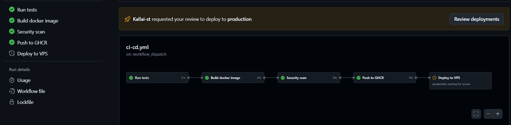
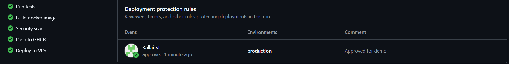
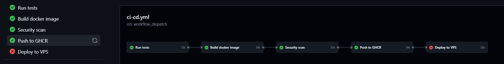

# 07 – Manual Approval Before Production Deployment

## Overview

Until now, every successful run on `main` was deployed to the server automatically. With this change, the `deploy` job only starts after a person has approved it. The tests, the image build, the security scan and the push to GHCR still run automatically; only the last step, which changes the live server, waits for a human decision.

```
test → build → security-scan → push-image → [approval] → deploy
```

This is a common pattern for production environments: automation prepares and checks everything, but a person decides when a new version goes live.

## How it works

GitHub environments support **deployment protection rules**. Because the `deploy` job already uses the `production` environment (see [06 – Automated Deployment to a VPS](06-deployment.md)), no change to the workflow file was needed:

```yaml
  deploy:
    name: Deploy to VPS
    environment:
      name: production
      url: http://${{ vars.DEPLOY_HOST }}
```

When a job references an environment that has required reviewers, GitHub pauses the job before it starts. The job does not receive the environment's secrets (the SSH key) until it is approved, so nothing can connect to the server before approval.

## Configuration

Settings → Environments → `production` → Deployment protection rules:

| Setting | Value | Reason |
|---|---|---|
| Required reviewers | `Kallai-st` | Only the repository owner can approve production deployments |
| Prevent self-review | Off | This is a single-person project; with this option on, the author of a change could not approve their own deployment |
| Deployment branches | `main` only | Unchanged from issue #6; deployments from other branches are not possible at all |

Required reviewers are available for environments in public repositories on all GitHub plans.

## Approving or rejecting a deployment

1. A run on `main` (after a merge, or started manually with **Run workflow**) goes through test, build, scan and push.
2. The `Deploy to VPS` job stops with the status **Waiting for review**.
3. The reviewer clicks **Review deployments**, selects `production`, optionally writes a comment and chooses:
   - **Approve and deploy**: the job runs and deploys the new image to the server.
   - **Reject**: the job is cancelled and fails; the server keeps running the previous version.

If nobody reacts, the pending deployment is cancelled automatically after 30 days.

## What a rejection does and does not do

- The **server is not changed**: the running container keeps the image tag stored in `~/cicd-sg/.env` on the server. This was checked after the rejection:
  ```bash
  ssh root@<host> "docker ps"   # image tag = commit SHA of the last approved run
  ```
- The **registry is changed**: `Push to GHCR` runs before the approval step, so the new image (and the `latest` tag) is already in GHCR. This is intentional. The image has passed all checks and is safe to store; the approval only controls what runs in production. The server never uses `latest`, it always runs the exact commit SHA written by the deploy job.

## Audit trail

Each decision is recorded on the workflow run under **Deployment protection rules**, showing who approved or rejected, when, for which environment and with what comment. The repository's **Deployments** view (right-hand sidebar of the main page) lists the deployment history of the `production` environment. Together, these show for every version on the server who released it.

## Screenshots

1. [](https://github.com/Kallai-st/cicd-sg/blob/main/docs/images/07-approval-settings.png)
   Deployment protection rules of the `production` environment with a required reviewer.

2. [](https://github.com/Kallai-st/cicd-sg/blob/main/docs/images/07-waiting-review.png)
   All checks have passed and the image is in GHCR; the `Deploy to VPS` job waits for approval.

3. [](https://github.com/Kallai-st/cicd-sg/blob/main/docs/images/07-approved.png)
   The deployment was approved by `Kallai-st` with the comment "Approved for demo", and the deploy job ran.

4. [](https://github.com/Kallai-st/cicd-sg/blob/main/docs/images/07-rejected.png)
   A rejected deployment: the deploy job did not run and the server kept the previous version.

## Limitations

- **Single reviewer:** in a real team, at least one reviewer other than the author would approve deployments (with **Prevent self-review** turned on). In a one-person project this is not possible, so the approval acts as a deliberate "release" step rather than a second pair of eyes.
- **Approval is not a code review:** the reviewer approves a version that has already been merged and scanned. Code review itself would be enforced on pull requests through the branch protection ruleset (required approvals), which is turned off in this project for the same reason.
