# 08 – Automatic Rollback

## Overview

Manual approval (see [07 – Manual Approval](07-manual-approval.md)) decides *when* a version goes live, but it cannot guarantee that the version works on the server. A version can pass every check in CI and still fail in production, because the production environment is different from the CI environment.

With this change, the `deploy` job remembers which version was running before the deployment. If the new version does not become healthy, the job automatically puts the previous version back and verifies it.

```
read previous tag → deploy new tag → verify /health
                                        │
                              ┌─────────┴─────────┐
                           healthy             unhealthy
                              │                   │
                        job succeeds     diagnostics → roll back → verify /health
                                                    → job still fails
```

The job stays **red** after a rollback. The service is restored, but the deployment did not succeed, and that must stay visible in the workflow history.

## How it works

Three steps were added to the `deploy` job of `.github/workflows/ci-cd.yml`; the existing steps are unchanged.

| Step | Runs | Purpose |
|---|---|---|
| `Record previous version` | before the deploy, always | Reads `IMAGE_TAG` from the server's `.env` and stores it as a step output |
| `Show container status on failure` | `if: failure()` | Prints `docker compose ps` and the last 50 log lines of the failed container |
| `Roll back to previous version` | `if: failure() && steps.previous.outputs.tag != ''` | Writes the previous tag back, starts it with `--wait`, and checks `/health` |

```yaml
      - name: Record previous version
        id: previous
        run: |
          PREV=$(ssh deploy-target "sed -n 's/^IMAGE_TAG=//p' ~/cicd-sg/.env 2>/dev/null" || true)
          # Only accept a full commit SHA; anything else means "no usable previous version"
          [[ "$PREV" =~ ^[0-9a-f]{40}$ ]] || PREV=""
          echo "tag=${PREV}" >> "$GITHUB_OUTPUT"
          echo "Previous version: ${PREV:-none (first deployment)}"
```

```yaml
      - name: Roll back to previous version
        if: failure() && steps.previous.outputs.tag != ''
        env:
          PREVIOUS_TAG: ${{ steps.previous.outputs.tag }}
        run: |
          echo "::warning::Deployment of ${IMAGE_TAG} failed - rolling back to ${PREVIOUS_TAG}"
          ssh deploy-target "cd ~/cicd-sg && echo 'IMAGE_TAG=${PREVIOUS_TAG}' > .env && docker compose pull && docker compose up -d --wait --wait-timeout 120"
          curl --fail --silent --show-error --retry 10 --retry-delay 3 --retry-all-errors "http://${DEPLOY_HOST}/health"
          echo
          echo "Rolled back from \`${IMAGE_TAG}\` to \`${PREVIOUS_TAG}\`" >> "$GITHUB_STEP_SUMMARY"
```

The order of the steps in the job is:

1. Copy compose file
2. **Record previous version**
3. Deploy with Docker Compose
4. Verify deployment
5. **Show container status on failure**
6. **Roll back to previous version**
7. Remove SSH key

## Key design decisions

- **The previous version is read from the server, not from GitHub.** The `.env` file on the server is the only reliable record of what is actually running. Looking at the previous commit in the repository would be wrong whenever a deployment was rejected or failed in between (see [07](07-manual-approval.md)).
- **The tag is validated before it is reused.** The value comes from a file on the server and is later placed into a remote command. The step accepts only a full 40-character commit SHA; anything else is treated as "no previous version", so a damaged or manipulated `.env` cannot inject anything into the rollback command.
- **The rollback uses the same health gate as a normal deployment.** `docker compose up --wait` followed by a `/health` check. A rollback that is not verified would only be a guess.
- **Diagnostics run before the rollback.** The failed container is replaced during the rollback, so its logs would be gone afterwards.
- **The rollback runs before the SSH key is removed.** The cleanup step (`if: always()`) must stay last, because the rollback needs the key.
- **The job fails even if the rollback succeeds.** A green run would hide the fact that the new version could not be deployed.
- **No external action is used.** As in the deployment itself, only plain `ssh` is used, which keeps the supply chain small.

## Demonstration

To test the rollback, a version was needed that **passes CI but fails on the server**. The two environments differ in one important way: the production container runs hardened (`read_only: true` in `deploy/docker-compose.yml`), while the smoke test in the `build` job starts the image with a plain `docker run`.

**The broken version:** `app/main.py` was changed to write a file to `/var/tmp` when the application starts (pull request #26, intentionally broken, reverted afterwards in #27). In CI the filesystem is writable, so the unit tests, the smoke test and the security scan all passed and the pull request was fully green.

**What happened on the server:** after the merge and the approval, the new container was created, but gunicorn could not start its worker:

```
OSError: [Errno 30] Read-only file system: '/var/tmp/startup.marker'
[ERROR] Reason: Worker failed to boot.
```

`docker compose up --wait` reported `container cicd-sg is unhealthy` after 9 seconds, and the `Deploy with Docker Compose` step failed. The `Verify deployment` step was skipped, the diagnostics step printed the traceback above, and the rollback step restored the previous version in 9 seconds. The whole `Deploy to VPS` job took 40 seconds; the broken container was live for roughly 20 seconds of that.

**The result:** the run ended red, but the server was running the previous commit again, healthy, with `/health` answering `{"status":"ok"}`. Afterwards the faulty change was reverted in a normal pull request, and the next deployment brought the fixed version to the server.

| Run | Version | Outcome |
|---|---|---|
| Merge of #25 (rollback feature) | `67903e2…` → `fa534ca…` | Deployment succeeded, rollback step skipped |
| Merge of #26 (broken demo version) | `fa534ca…` → `57d8027…` | Deployment failed, rolled back to `fa534ca…` |
| Merge of #27 (revert) | `fa534ca…` → `90cdd8f…` | Deployment succeeded |

## Screenshots

1. [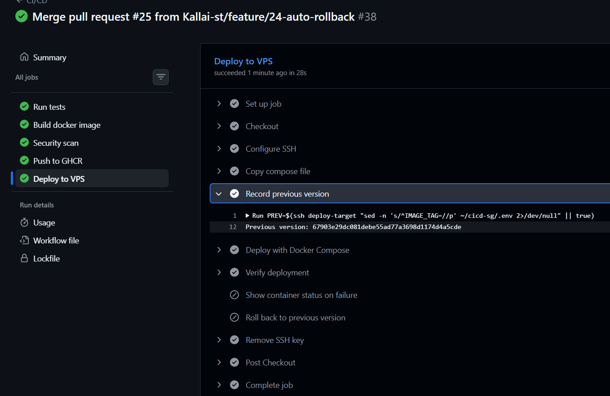](https://github.com/Kallai-st/cicd-sg/blob/main/docs/images/08-happy-path.png)
   A normal deployment: `Record previous version` printed the running version, and the two failure steps (`Show container status on failure`, `Roll back to previous version`) were skipped.

2. [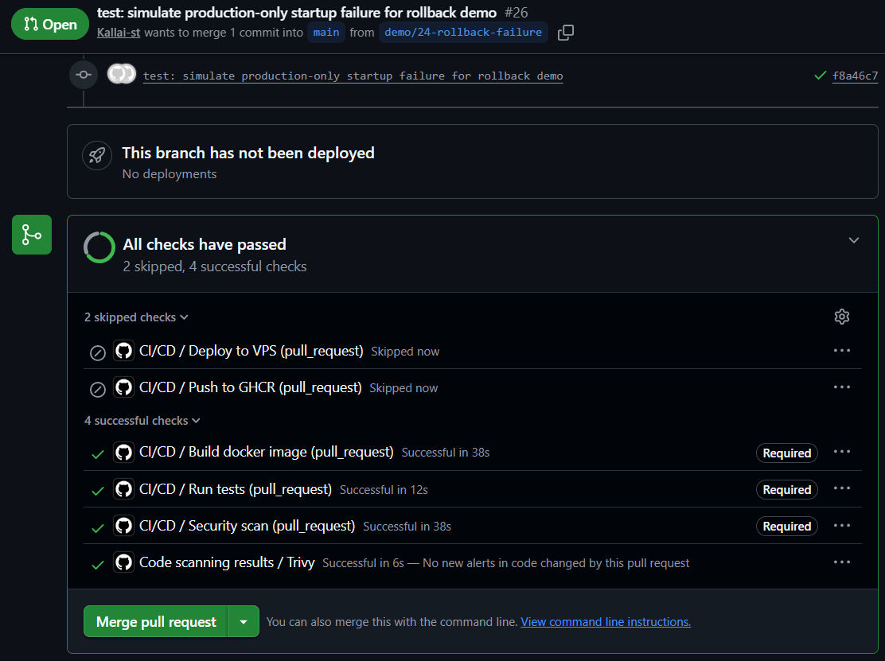](https://github.com/Kallai-st/cicd-sg/blob/main/docs/images/08-demo-pr-green.png)
   Pull request #26 with the broken version: all required checks passed, because CI cannot see the difference between its own environment and the hardened production container.

3. [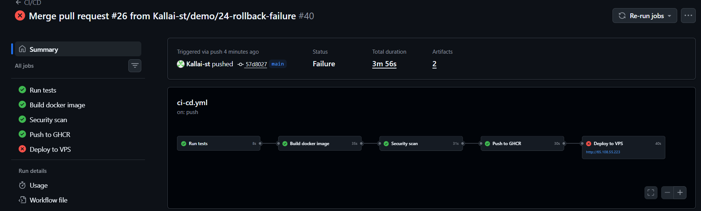](https://github.com/Kallai-st/cicd-sg/blob/main/docs/images/08-run-failed.png)
   The run after the merge: every job up to `Push to GHCR` is green, `Deploy to VPS` is red.

4. [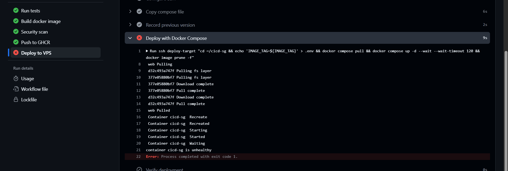](https://github.com/Kallai-st/cicd-sg/blob/main/docs/images/08-container-crash-01.png)
   The diagnostics step: the new container (`57d8027…`) is only seconds old and its health check is still `starting`; the log begins with the gunicorn traceback.

5. [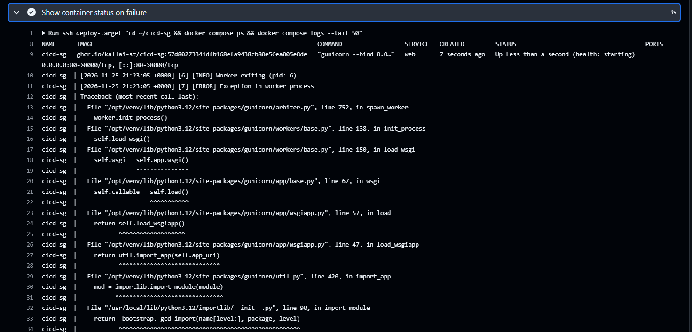](https://github.com/Kallai-st/cicd-sg/blob/main/docs/images/08-container-crash-02.png)
   The traceback leads from gunicorn's worker start to `create_app()` in `app/main.py` and the failing write; the error is `Read-only file system`.

6. [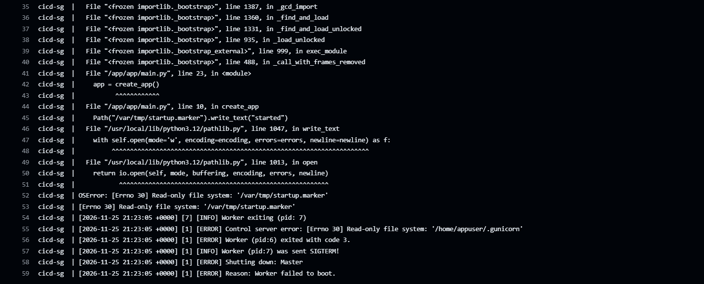](https://github.com/Kallai-st/cicd-sg/blob/main/docs/images/08-container-crash-03.png)
   The end of the log: `Worker failed to boot`, so the container never becomes healthy.

7. [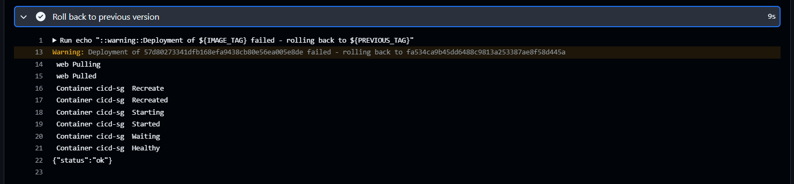](https://github.com/Kallai-st/cicd-sg/blob/main/docs/images/08-rollback-log.png)
   The rollback step: a warning with both versions, the old container is recreated and becomes `Healthy`, and `/health` returns `{"status":"ok"}`.

8. [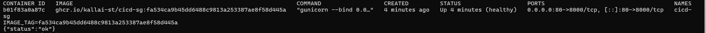](https://github.com/Kallai-st/cicd-sg/blob/main/docs/images/08-health-after-rollback.png)
   The server after the failed deployment: the container runs the previous version (`fa534ca…`), `.env` contains the same tag, and `/health` answers `ok`.

## Limitations

- **Short interruption:** there is one container and no blue-green setup. Between the start of the broken container and the end of the rollback (about 20 seconds in the demonstration) the service is not available.
- **Only the health check decides:** a version that answers `/health` correctly but is broken elsewhere is not detected and not rolled back.
- **One version back:** the rollback restores the version recorded before this deployment. It is not a general "go back to any version" tool.
- **First deployment:** if the server has no valid `.env` yet, there is nothing to restore. The job fails and the rollback step is skipped.
- **The registry is not cleaned up:** the failed image and the `latest` tag stay in GHCR. This is harmless because the server never uses `latest`, it always runs the exact commit SHA, but `latest` can point to a version that failed in production.
- **The demonstration stays in the history:** the broken version (#26) and its revert (#27) remain in the repository history as the evidence of the test.

## Follow-up: production-like smoke test

The rollback demo exposed a gap between CI and production: the smoke test in the `build` job started the container with a plain `docker run`, while the server runs it with the hardening options from `deploy/docker-compose.yml`. The broken image from #26 therefore passed every required check and failed only on the server, where the rollback had to step in.

To close this gap, the smoke test now starts the container with the same restrictions as production:

```yaml
docker run -d --name smoke -p 8000:8000 --read-only --tmpfs /tmp --cap-drop ALL --security-opt no-new-privileges:true --memory 256m cicd-sg:${{ github.sha }}
```

| `docker run` flag | `docker-compose.yml` equivalent |
|---|---|
| `--read-only` | `read_only: true` |
| `--tmpfs /tmp` | `tmpfs: /tmp` |
| `--cap-drop ALL` | `cap_drop: ALL` |
| `--security-opt no-new-privileges:true` | `security_opt: no-new-privileges:true` |
| `--memory 256m` | `mem_limit: 256m` |

### Key design decisions

- **Shift left.** Rollback limits the damage of a bad release; catching the failure in the pull request prevents the release altogether. A broken image now never reaches the registry, so the `latest` tag and the server stay untouched.
- **Rollback stays.** The smoke test cannot reproduce every difference between CI and production (network, host resources, real traffic), so automatic rollback remains the last line of defence.
- **Flags are duplicated by hand.** The restrictions are listed both in the workflow and in the compose file. A change to one must be mirrored in the other; this is noted as a limitation below.

### Demo

**Setup.** The intentionally broken commit from #26 (writing to `/var/tmp` at startup) was re-applied on a throwaway `demo/` branch and opened as a pull request.

**Result.** `Run tests` passed, but `Build docker image` failed in the *Smoke test - check /health endpoint* step after `curl` exhausted its retries. The container logs show the same error as on the server during the rollback demo: `OSError: [Errno 30] Read-only file system: '/var/tmp/startup.marker'`, followed by `HaltServer 'Worker failed to boot.'`. `Security scan`, `Push to GHCR` and `Deploy to VPS` were skipped, and merging was blocked by the required checks.

**Outcome.** The same change that previously reached production (and triggered a rollback) is now stopped in CI. The pull request was closed without merging.

### Screenshots

1. Pull request with the failing `Build docker image` check and the merge blocked

   [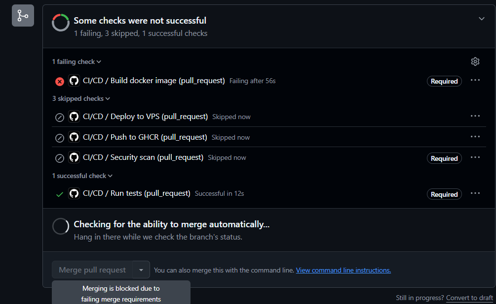](https://github.com/Kallai-st/cicd-sg/blob/main/docs/images/08-smoke-pr-failed.png)

   *The required `Build docker image` check fails; later jobs are skipped.*

2. Health check retries failing in the smoke test

   [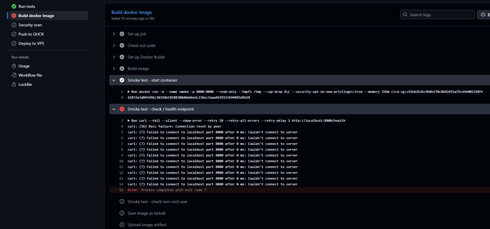](https://github.com/Kallai-st/cicd-sg/blob/main/docs/images/08-smoke-curl-failed.png)

   *The container starts with production-like flags, but `/health` never answers.*

3. Container logs showing the root cause

   [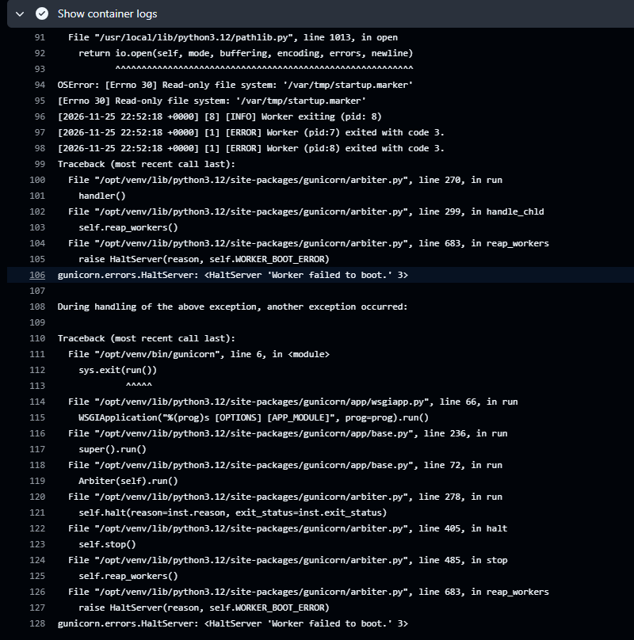](https://github.com/Kallai-st/cicd-sg/blob/main/docs/images/08-smoke-log-readonly.png)

   *Gunicorn workers crash on the read-only filesystem: `Worker failed to boot`.*

### Limitations

- The container restrictions are defined twice (workflow and compose file) and can drift apart if only one is updated.
- The smoke test still runs on a GitHub-hosted runner, not on the target host, so host-specific issues (disk, network, kernel) remain covered only by the rollback.
