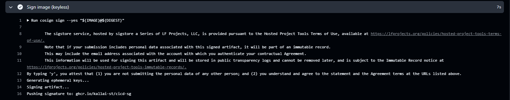
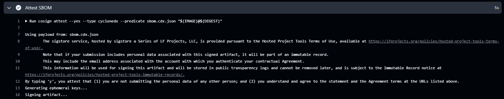
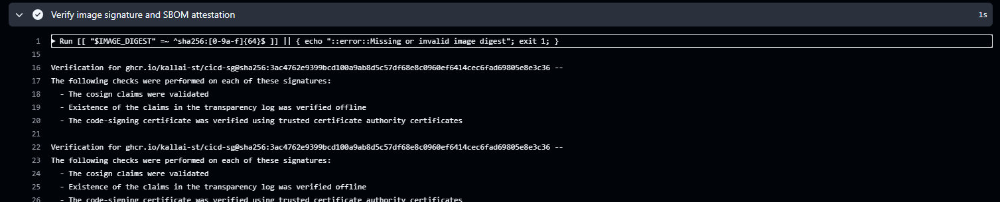
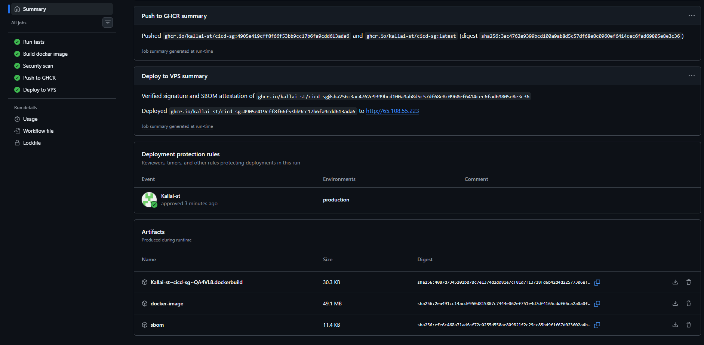
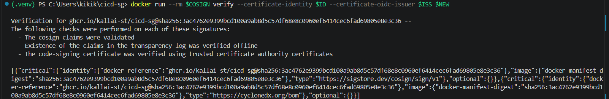
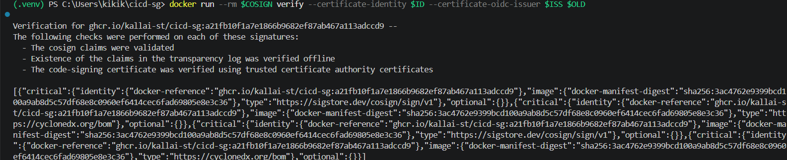
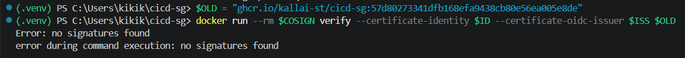
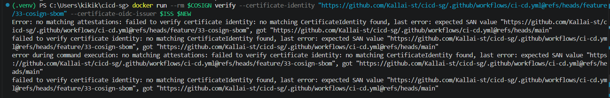
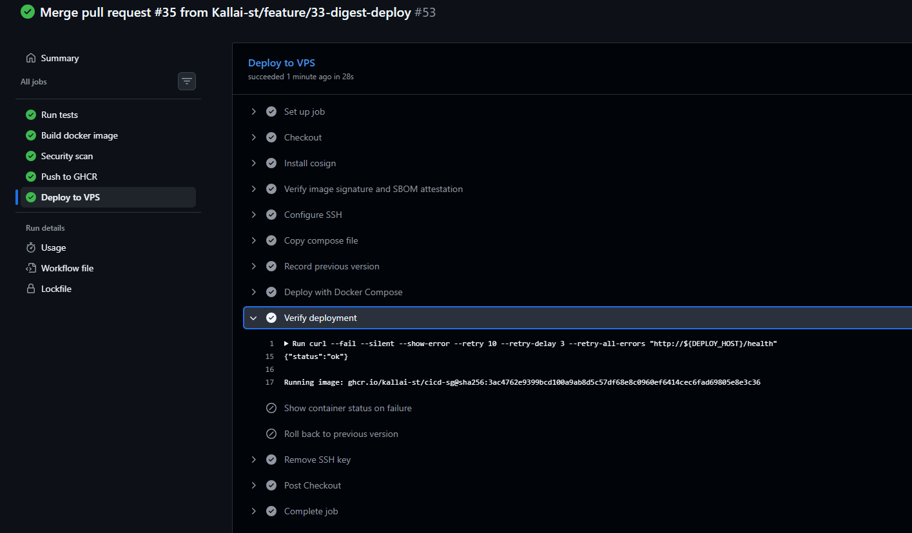
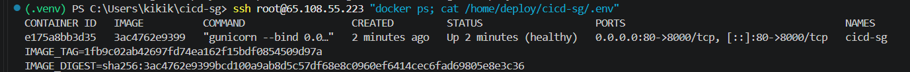

# 09 – Image signing and SBOM

## Overview

Until now the pipeline guaranteed that an image in the registry had passed the tests, the smoke test and the Trivy gate. It did not guarantee that the server actually runs *that* image: a tag such as `:<commit SHA>` or `:latest` is only a movable pointer, and anyone with write access to the registry could point it at different content.

This chapter closes that gap with three additions (issue #33, implemented in PR #34 – signing, SBOM and verification – and PR #35 – deploying by digest):

1. **Keyless signing with cosign.** After the push, the `push-image` job signs the image **by digest**. No key pair is stored anywhere: the job proves its identity with a short-lived GitHub OIDC token, Sigstore issues a short-lived certificate for that identity, and the signature is recorded in the public Rekor transparency log.
2. **SBOM attestation.** Trivy generates a CycloneDX SBOM (the list of packages and versions in the image). cosign signs it and attaches it to the image as an attestation, and it is also uploaded as a workflow artifact.
3. **Verify, then deploy the verified digest.** Before touching the server, the `deploy` job verifies the signature and the SBOM attestation against the expected identity (this repository's workflow on `main`). The server then pulls the image **by that exact digest**, and the job checks that the running container uses it.

## How it works

| Step | Job | What happens | Fails when |
|---|---|---|---|
| Tag and push image | `push-image` | Pushes `:<SHA>` and `:latest`, reads the image digest (`sha256:…`) and exposes it as a job output | The digest cannot be determined |
| Sign image (keyless) | `push-image` | `cosign sign` on `image@digest` using the job's OIDC identity | Sigstore or the registry is unavailable |
| Generate SBOM | `push-image` | Trivy writes `sbom.cdx.json` (CycloneDX) from the same image tarball that was scanned | – |
| Attest SBOM | `push-image` | `cosign attest --type cyclonedx` signs the SBOM and attaches it to `image@digest` | Sigstore or the registry is unavailable |
| Upload SBOM artifact | `push-image` | The SBOM is kept as the `sbom` workflow artifact for 30 days | – |
| Verify image signature and SBOM attestation | `deploy` | `cosign verify` + `cosign verify-attestation` with a pinned certificate identity and OIDC issuer | No signature, wrong signer, or the image was changed after signing |
| Deploy with Docker Compose | `deploy` | `.env` gets `IMAGE_TAG` and `IMAGE_DIGEST`; Compose pulls `image@digest` | Container does not become healthy |
| Verify deployment | `deploy` | `/health` check, and the running container's image must equal `image@digest` | Health check fails or a different image is running |
| Roll back to previous version | `deploy` | Restores the previous `IMAGE_TAG` + `IMAGE_DIGEST` from the server's `.env` | – |

### Signing and SBOM in `push-image`

```yaml
  push-image:
    name: Push to GHCR
    runs-on: ubuntu-24.04
    needs: security-scan
    if: github.event_name != 'pull_request' && github.ref == 'refs/heads/main'
    permissions:
      contents: read
      packages: write
      id-token: write
    outputs:
      digest: ${{ steps.push.outputs.digest }}
    steps:
      # ... download artifact, docker load, log in to GHCR ...

      - name: Tag and push image
        id: push
        run: |
          IMAGE="ghcr.io/${GITHUB_REPOSITORY,,}"
          docker tag "cicd-sg:${GITHUB_SHA}" "${IMAGE}:${GITHUB_SHA}"
          docker tag "cicd-sg:${GITHUB_SHA}" "${IMAGE}:latest"
          docker push "${IMAGE}:${GITHUB_SHA}"
          docker push "${IMAGE}:latest"
          DIGEST=$(docker inspect --format '{{index .RepoDigests 0}}' "${IMAGE}:${GITHUB_SHA}")
          DIGEST="${DIGEST#*@}"
          [[ "$DIGEST" =~ ^sha256:[0-9a-f]{64}$ ]] || { echo "::error::Could not determine image digest"; exit 1; }
          echo "image=${IMAGE}" >> "$GITHUB_OUTPUT"
          echo "digest=${DIGEST}" >> "$GITHUB_OUTPUT"

      - name: Install cosign
        uses: sigstore/cosign-installer@756fe2d284c7292c4e9b62c8a28f1e5629c59532 # v4.1.3

      - name: Sign image (keyless)
        env:
          IMAGE: ${{ steps.push.outputs.image }}
          DIGEST: ${{ steps.push.outputs.digest }}
        run: cosign sign --yes "${IMAGE}@${DIGEST}"

      - name: Generate SBOM
        uses: aquasecurity/trivy-action@ed142fd0673e97e23eac54620cfb913e5ce36c25 # v0.36.0
        with:
          scan-type: image
          input: ${{ runner.temp }}/image.tar
          format: cyclonedx
          output: sbom.cdx.json

      - name: Attest SBOM
        env:
          IMAGE: ${{ steps.push.outputs.image }}
          DIGEST: ${{ steps.push.outputs.digest }}
        run: cosign attest --yes --type cyclonedx --predicate sbom.cdx.json "${IMAGE}@${DIGEST}"
```

### Verification in `deploy`

The job gets `IMAGE: ghcr.io/kallai-st/cicd-sg` and `IMAGE_DIGEST: ${{ needs.push-image.outputs.digest }}` in its `env`. The verification runs right after the checkout, before `Configure SSH`:

```yaml
      - name: Verify image signature and SBOM attestation
        run: |
          [[ "$IMAGE_DIGEST" =~ ^sha256:[0-9a-f]{64}$ ]] || { echo "::error::Missing or invalid image digest"; exit 1; }
          IDENTITY="https://github.com/Kallai-st/cicd-sg/.github/workflows/ci-cd.yml@refs/heads/main"
          ISSUER="https://token.actions.githubusercontent.com"
          cosign verify --certificate-identity "$IDENTITY" --certificate-oidc-issuer "$ISSUER" "${IMAGE}@${IMAGE_DIGEST}" > /dev/null
          cosign verify-attestation --type cyclonedx --certificate-identity "$IDENTITY" --certificate-oidc-issuer "$ISSUER" "${IMAGE}@${IMAGE_DIGEST}" > /dev/null
```

### Deploying by digest

`deploy/docker-compose.yml`:

```yaml
    image: ghcr.io/kallai-st/cicd-sg@${IMAGE_DIGEST:?IMAGE_DIGEST must be set in .env}
```

The server's `.env` now holds two lines – the commit (for humans) and the digest (what actually runs):

```
IMAGE_TAG=<commit SHA>
IMAGE_DIGEST=sha256:<digest>
```

`Verify deployment` checks the running container against the verified digest:

```bash
RUNNING=$(ssh deploy-target "docker inspect --format '{{.Config.Image}}' cicd-sg")
[[ "$RUNNING" == "${IMAGE}@${IMAGE_DIGEST}" ]] || { echo "::error::Running image does not match the verified digest"; exit 1; }
```

`Record previous version` reads both values from the server's `.env` and only accepts them together (a 40-character commit SHA and a full `sha256:` digest). The rollback writes both back, so it also restores an exact digest.

## Key design decisions

- **Keyless instead of a key pair.** A long-lived signing key would be one more secret to store, rotate and protect. With keyless signing the "key" is the workflow's identity: the certificate is valid for minutes and is bound to `Kallai-st/cicd-sg/.github/workflows/ci-cd.yml@refs/heads/main`.
- **Sign the digest, not the tag.** A tag can be moved to other content; a digest is the hash of the content itself. The signature therefore belongs to the content, and every tag pointing to the same content verifies with the same signature.
- **The expected identity is pinned, not derived.** Having *a* valid signature is not enough – a fork or another branch could also produce one, but with a different identity in the certificate. The identity and the OIDC issuer are written out literally in the verification step instead of being computed from the running workflow's context.
- **`id-token: write` only on `push-image`.** Only the job that signs can request an OIDC token. The other jobs keep their minimal permissions.
- **Verify before touching the server.** The verification step runs before `Configure SSH`. If it fails, nothing is copied to the server, `Record previous version` never runs, and therefore the rollback step (`steps.previous.outputs.tag != ''`) is skipped too. Placing it after `Record previous version` would have triggered a pointless "rollback" of a server that was never changed.
- **Deploy exactly what was verified.** Verifying a digest and then pulling a tag would leave a window in which the tag could be moved. The server now pulls `image@digest`, and the job confirms the running container uses that digest. The `IMAGE_TAG` in `.env` is kept only to show which commit is running.
- **No silent fallback.** The Compose file used to default to `:latest` when `IMAGE_TAG` was missing. `${IMAGE_DIGEST:?…}` makes Compose stop with an error instead.
- **SBOM from the scanned image.** The SBOM is generated with the same pinned Trivy action from the same tarball that passed the security scan, so it describes exactly the image that was pushed and signed. It is attested (signed and attached to the image) and also kept as a downloadable artifact.
- **No personal data in the transparency log.** cosign prints a notice that signing data is stored in a public, immutable log. The signature is made with the workflow's OIDC identity, not a personal GitHub account, so the log only contains the repository, workflow file and branch – information that is public anyway. `--yes` accepts the notice non-interactively.
- **Pinned actions.** `sigstore/cosign-installer` is pinned to the commit of v4.1.3 (checked on the releases page), like the Trivy action. cosign-installer v4 is required for cosign v3.

## Demo

**Pipeline run.** After merging PR #34, the `Push to GHCR` job signed the image (`Pushing signature to: ghcr.io/kallai-st/cicd-sg`) and attached the SBOM. After approval, `Deploy to VPS` verified both before connecting to the server, and the run summary listed the digest, the verification result and the `sbom` artifact.

**Local verification.** cosign does not need to be installed locally – the official cosign image can run it:

```powershell
$COSIGN = "ghcr.io/sigstore/cosign/cosign:v3.1.4"
$ISS = "https://token.actions.githubusercontent.com"
$ID = "https://github.com/Kallai-st/cicd-sg/.github/workflows/ci-cd.yml@refs/heads/main"
docker run --rm $COSIGN verify --certificate-identity $ID --certificate-oidc-issuer $ISS ghcr.io/kallai-st/cicd-sg@sha256:<digest>
```

**Signed image.** Verifying the new digest succeeded. cosign reported three checks: the signed claims match the digest, the entry exists in the transparency log (verified offline from the stored proof), and the certificate was issued by the Sigstore certificate authority. The output contained two entries for the same digest: the signature (`https://sigstore.dev/cosign/sign/v1`) and the SBOM attestation (`https://cyclonedx.org/bom`).

**Same content, same signature.** Verifying the *previous* commit's tag – an image pushed before signing existed – unexpectedly succeeded. The output showed why: its `docker-manifest-digest` was identical to the new one. The signing change only touched the workflow, not the application or the Dockerfile, so the cached build produced bit-for-bit the same image. Both tags point to the same content, and the signature belongs to the content. Verified again after PR #35, the same digest listed four entries – two signatures and two SBOM attestations – because both pipeline runs (PR #34 and PR #35) built and signed identical content, and each run added its own signature and attestation.

**Unsigned image.** An image with different content – the intentionally broken image from the rollback demo (chapter 08) – failed verification because no signature exists for its digest.

**Wrong identity.** Verifying the signed image while expecting a different signer (the same workflow, but on the `feature/33-cosign-sbom` branch) failed: the signature is valid, but the identity in the certificate (`…@refs/heads/main`) does not match the expected one.

**Deploy by digest.** After PR #35, the `Verify deployment` step printed `Running image: ghcr.io/kallai-st/cicd-sg@sha256:3ac4762e…`, matching the verified digest, and the server's `.env` contained both `IMAGE_TAG` and `IMAGE_DIGEST`. In the verification step two `Verification for …` blocks appear for the same digest: one for the signature and one for the SBOM attestation.

## Screenshots

1. Signing step in the `Push to GHCR` job

   [](https://github.com/Kallai-st/cicd-sg/blob/main/docs/images/09-sign-image.png)

   *Keyless signing of the pushed image by digest; the signature is pushed next to the image in GHCR.*

2. SBOM attestation in the `Push to GHCR` job

   [](https://github.com/Kallai-st/cicd-sg/blob/main/docs/images/09-attest-sbom.png)

   *The CycloneDX SBOM is signed and attached to the image as an attestation.*

3. Verification in the `Deploy to VPS` job

   [](https://github.com/Kallai-st/cicd-sg/blob/main/docs/images/09-verify-signature.png)

   *Signature and SBOM attestation are verified against the pinned identity before the server is touched.*

4. Run summary

   [](https://github.com/Kallai-st/cicd-sg/blob/main/docs/images/09-run-summary.png)

   *The summary shows the pushed digest, the verification result and the `sbom` artifact.*

5. Local verification of the signed image

   [](https://github.com/Kallai-st/cicd-sg/blob/main/docs/images/09-verify-local-ok.png)

   *cosign confirms the signature and lists both the signature and the SBOM attestation for the digest.*

6. Old tag, same digest

   [](https://github.com/Kallai-st/cicd-sg/blob/main/docs/images/09-verify-local-same-digest.png)

   *The previous commit's tag verifies too, because it points to the same content (identical digest). The two pipeline runs each added a signature and an SBOM attestation to that digest.*

7. Unsigned image

   [](https://github.com/Kallai-st/cicd-sg/blob/main/docs/images/09-verify-local-unsigned.png)

   *An image with different content and no signature fails verification.*

8. Wrong identity

   [](https://github.com/Kallai-st/cicd-sg/blob/main/docs/images/09-verify-local-wrong-identity.png)

   *A valid signature is rejected when it does not come from the expected workflow and branch.*

9. Deployment verified by digest

   [](https://github.com/Kallai-st/cicd-sg/blob/main/docs/images/09-digest-verify-deployment.png)

   *The running container uses exactly the verified digest.*

10. Server state

    [](https://github.com/Kallai-st/cicd-sg/blob/main/docs/images/09-digest-server.png)

    *`.env` contains both `IMAGE_TAG` and `IMAGE_DIGEST`. Because the image was pulled by digest without a tag, `docker ps` shows the short image ID (`3ac4762e9399`) instead of a tag.*

## Limitations

- **Transition without a rollback target.** The first deployment after switching to digests found no `IMAGE_DIGEST` in the server's `.env`, so it had no usable previous version and could not have rolled back. From the second deployment on, rollback works as before.
- **The rollback target is not re-verified.** The previous digest was verified when it was first deployed, and the rollback restores it from the server's `.env` without calling cosign again.
- **A signature proves origin, not safety.** It shows the image was built by this repository's workflow on `main`. Whether the code on `main` is trustworthy still depends on branch protection, the required checks and the manual approval.
- **Dependency on public infrastructure.** Signing and verification need GitHub OIDC, the Sigstore services (Fulcio, Rekor) and GHCR. If they are unavailable, no new version can be released – the running version is not affected.
- **Verification happens in the pipeline, not on the server.** The server itself does not check signatures; anyone with root or `docker` access on the server could still start an unsigned image. Enforcement on the host (or an admission controller in Kubernetes) is out of scope.
- **The SBOM is not evaluated yet.** It is generated, signed and stored, but no policy (for example licences or banned packages) is checked against it.
- **Older images are unsigned.** Images pushed before this change carry no signature unless their content is identical to a signed image.
