# 10 – Dependency updates and repository scanning

## Overview

The earlier chapters protect the pipeline at the image level: Trivy scans the built image, cosign signs it, and the deploy job only runs what was verified. Two gaps remained on the **source** side:

1. **Pinned versions never update themselves.** Third-party actions are pinned to commit SHAs and Python packages were only loosely constrained. Without a process, pinned versions slowly fall behind and miss security fixes.
2. **The repository itself was not checked.** A secret committed by mistake stays in the git history even after the file is deleted, and a Dockerfile can contain bad practices before any image exists.

This chapter adds:

- **Dependabot** (issue #37), which proposes weekly, grouped updates for GitHub Actions and pip packages as pull requests. Every update goes through the full pipeline before it can be merged.
- **A `Repository scan` job** (issue #41) that runs **gitleaks** over the whole git history and **hadolint** on the Dockerfile. It is a required check, and the image is not pushed without it.

Both follow the same "shift left" idea as the production-like smoke test (chapter 08): catch problems as early and as cheaply as possible.

## How it works

| Part | Where | What it does | Fails / acts when |
|---|---|---|---|
| Dependabot – GitHub Actions | `.github/dependabot.yml` | Checks every `uses:` line weekly; updates tags, SHAs and `# vX.Y.Z` comments | A newer version exists → opens one grouped PR |
| Dependabot – pip | `.github/dependabot.yml` | Checks `requirements*.txt` weekly | A newer version exists → opens one grouped PR |
| Pinned dependencies | `requirements.txt`, `requirements-dev.txt` | Exact versions (`==`) instead of ranges | – |
| gitleaks | `repo-scan` job | Scans every commit of the repository for secrets | Any finding |
| hadolint | `repo-scan` job | Lints the Dockerfile | Any finding (including `info`) |
| Required check | Branch ruleset | `Repository scan` must pass before merging | The job is red |
| Push gate | `push-image` job | `needs: [security-scan, repo-scan]` | The repository scan did not pass |

### Dependabot configuration

```yaml
version: 2
updates:
  - package-ecosystem: github-actions
    directory: /
    schedule:
      interval: weekly
      day: monday
      timezone: Europe/Budapest
    groups:
      github-actions:
        patterns:
          - "*"
    commit-message:
      prefix: ci
      include: scope

  - package-ecosystem: pip
    directory: /
    schedule:
      interval: weekly
      day: monday
      timezone: Europe/Budapest
    groups:
      python-packages:
        patterns:
          - "*"
    commit-message:
      prefix: build
      include: scope
```

`requirements.txt`:

```
flask==3.1.3
gunicorn==26.2.0
```

`requirements-dev.txt` pins `pytest==9.2.0`. The versions were read from the image that was running in production at the time, so pinning did not change behaviour.

### Repository scan job

```yaml
  repo-scan:
    name: Repository scan
    runs-on: ubuntu-24.04
    env:
      GITLEAKS_IMAGE: ghcr.io/gitleaks/gitleaks:v8.30.1@sha256:c00b6bd0aeb3071cbcb79009cb16a60dd9e0a7c60e2be9ab65d25e6bc8abbb7f
      HADOLINT_IMAGE: hadolint/hadolint:v2.15.1@sha256:32dac94127fd60b7b7e3fbfc65e1383b9b5e25c9bfd7b8536de7a539fe68a12d
    steps:
      - name: Check out repository (full history)
        uses: actions/checkout@v7
        with:
          fetch-depth: 0
          persist-credentials: false

      - name: Scan git history for secrets (gitleaks)
        run: docker run --rm -v "${GITHUB_WORKSPACE}:/repo" "$GITLEAKS_IMAGE" git /repo --redact -v

      - name: Lint Dockerfile (hadolint)
        if: success() || failure()
        run: docker run --rm -i "$HADOLINT_IMAGE" < Dockerfile
```

The job runs in parallel with `Run tests`, so it does not slow the pipeline down. `push-image` waits for it:

```yaml
  push-image:
    needs: [security-scan, repo-scan]
```

### Dockerfile fixes

The first hadolint run reported four findings. All four were fixed instead of being suppressed:

| Line | Rule | Finding | Fix |
|---|---|---|---|
| 9 | DL3045 | `COPY` to a relative destination without `WORKDIR` (builder stage) | `WORKDIR /build` before the `COPY` |
| 10 | DL3013 | Unpinned `pip install --upgrade pip` | Removed – pip is uninstalled from the final image anyway |
| 31 | DL3066 | Non-numeric `USER appuser` | `USER 10001` (the same user; `whoami` still prints `appuser`) |
| 35 | DL3025 | `HEALTHCHECK` in shell form | Exec (JSON) form; `|| exit 1` dropped because Python already exits with 1 on an exception |

```dockerfile
USER 10001

HEALTHCHECK --interval=30s --timeout=3s --start-period=10s --retries=3 \
  CMD ["python", "-c", "import urllib.request; urllib.request.urlopen('http://localhost:8000/health')"]
```

Because `docker compose up --wait` in the deploy job depends on the health check, the new `HEALTHCHECK` was tested locally before pushing (`docker inspect --format "{{.State.Health.Status}}"` → `healthy`). The CI smoke test checks `/health` directly and would not have noticed a broken health check.

## Key design decisions

- **Pin exact versions so updates become visible.** With `flask>=3.1` Dependabot has nothing to update, because the range already allows the newest version. At the same time the build did not really install "the newest": the GitHub Actions build cache reused the pip layer until `requirements.txt` changed, so the installed versions were invisible. Exact pins make every version change an explicit, reviewed pull request.
- **Group updates per ecosystem.** For a one-person project one PR per ecosystem per week is manageable; one PR per package would not be.
- **Dependabot proposes, a human decides.** Every Dependabot PR runs the full pipeline (tests, build, production-like smoke test, Trivy, repository scan). Major version updates are additionally checked against the release notes before merging (see Demo).
- **No third-party JavaScript actions for the scanners.** gitleaks and hadolint run from their official container images, pinned by digest (`tag@sha256:…`). The tag is kept only for readability; Docker uses the digest. This follows the same rule as the cosign chapter: pin the content, not the label.
- **Scan the whole history.** `fetch-depth: 0` downloads every commit. A secret that was committed and later deleted is still in the history and still has to be found.
- **No credentials for the scanners.** `persist-credentials: false` keeps the git token out of the checkout, so the scanner containers cannot use it.
- **Report both scanners in one run.** `if: success() || failure()` lets hadolint run even when gitleaks has already failed.
- **Fix findings rather than ignore them.** No hadolint rule was disabled; each finding led to a real improvement.
- **Gate both the merge and the push.** `Repository scan` is a required status check in the branch ruleset, and `push-image` depends on it, so a failing scan blocks the merge and could never publish an image.
- **A generic key for the secret demo.** A fake GitHub token (`ghp_…`) might have been rejected by GitHub's own push protection before the pipeline ever saw it. A generic API key is detected by gitleaks via the keyword (`API_KEY`) and the high entropy of the value.

## Demo

**Dependabot.** After the configuration was merged, Dependabot immediately checked both ecosystems and opened two grouped pull requests:

- **#39 – pip:** `gunicorn` 26.2.0 → 27.0.1. This is a major version, so the release notes were checked: the breaking changes concern ASGI applications and requests with a `Transfer-Encoding` that does not end in `chunked` – neither applies to a Flask (WSGI) app behind normal clients. More importantly, `Build docker image` was green, so the production-like smoke test had already started the container with gunicorn 27.
- **#40 – GitHub Actions:** `actions/checkout` v5 → v7 and `actions/setup-python` v6 → v7. The relevant changes (checkout refusing fork code for `pull_request_target`/`workflow_run`, credentials stored outside `.git/config`, setup-python's internal ESM migration) did not require any workflow change, and all checks passed.

Both were merged one at a time; Dependabot rebased the second PR automatically. After deployment the server was healthy with gunicorn 27.

**hadolint finds real issues.** Run locally, hadolint reported the four findings listed above. The repository scan job was then pushed **before** the Dockerfile fix, so the pull request showed the gate working in CI: `Repository scan` failed at "Lint Dockerfile (hadolint)" with the same four findings and exit code 1, while gitleaks passed. After the fix was pushed, all four checks were green.

**gitleaks on a clean history.** The first local run scanned 34 commits and reported `no leaks found`.

**gitleaks catches a committed secret.** On a demo branch a fake API key was committed to `app/settings.py`:

```python
# DEMO ONLY: fake credential to show that the repository scan blocks committed secrets.
API_KEY = "<random 32-character string>"
```

Locally, gitleaks reported one finding (`RuleID: generic-api-key`, entropy 5.0, file, line, commit and a direct link) with the value redacted, and `leaks found: 1`. In the pull request (#43), `Repository scan` failed at the gitleaks step while tests, build and the image scan passed; since it is a required check, GitHub reported "Merging is blocked due to failing merge requirements". The pull request was closed without merging and the branch deleted.

## Screenshots

1. Dependabot status – GitHub Actions

   [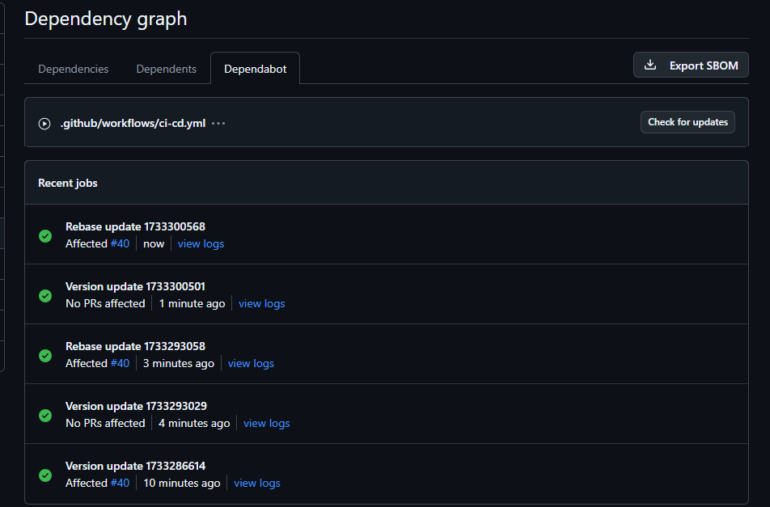](https://github.com/Kallai-st/cicd-sg/blob/main/docs/images/10-dependabot-status-01.png)

   *Dependabot's update jobs for the workflow actions; the rebase jobs keep PR #40 up to date with `main`.*

2. Dependabot status – pip

   [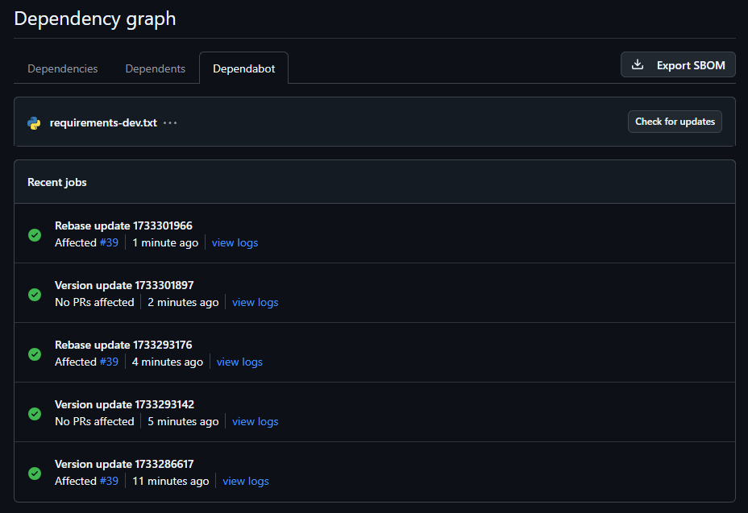](https://github.com/Kallai-st/cicd-sg/blob/main/docs/images/10-dependabot-status-02.png)

   *Dependabot's update jobs for the pip dependencies (PR #39).*

3. Dependabot pull requests

   [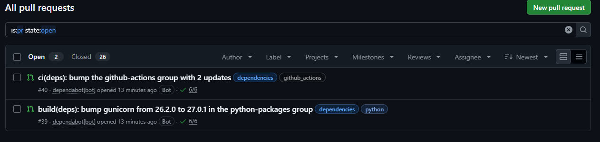](https://github.com/Kallai-st/cicd-sg/blob/main/docs/images/10-dependabot-prs.png)

   *Two grouped PRs with Conventional Commit titles; all checks passed on both.*

4. Actions update details

   [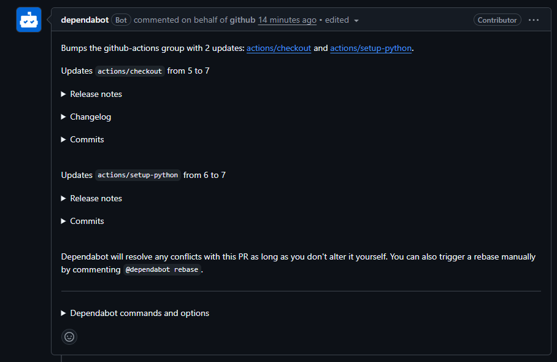](https://github.com/Kallai-st/cicd-sg/blob/main/docs/images/10-dependabot-pr-actions.png)

   *`actions/checkout` 5 → 7 and `actions/setup-python` 6 → 7 in one PR.*

5. hadolint findings (local)

   [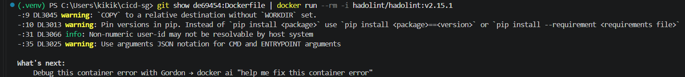](https://github.com/Kallai-st/cicd-sg/blob/main/docs/images/10-hadolint-findings.png)

   *Four findings in the original Dockerfile.*

6. hadolint clean and health check verified (local)

   [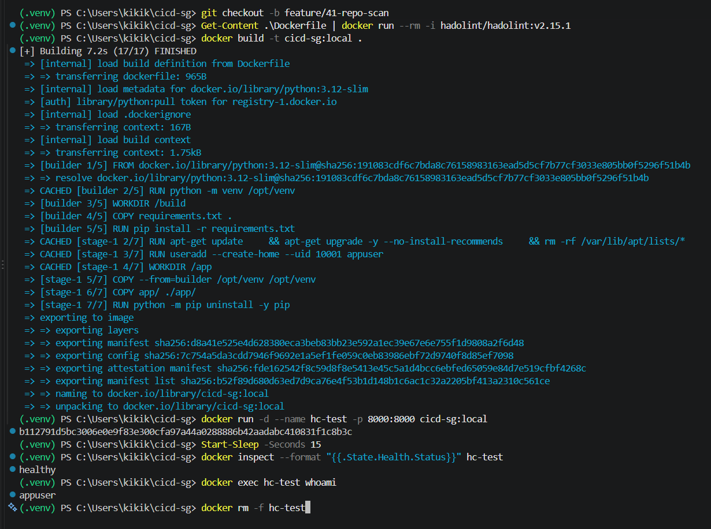](https://github.com/Kallai-st/cicd-sg/blob/main/docs/images/10-hadolint-clean.png)

   *No findings after the fix; the rebuilt container is `healthy` and runs as `appuser`.*

7. hadolint gate in CI

   [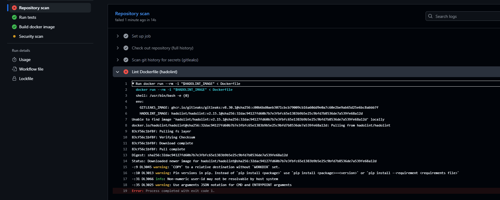](https://github.com/Kallai-st/cicd-sg/blob/main/docs/images/10-hadolint-ci-failed.png)

   *The repository scan fails on the unfixed Dockerfile; the image is pulled by digest.*

8. hadolint passing in CI

   [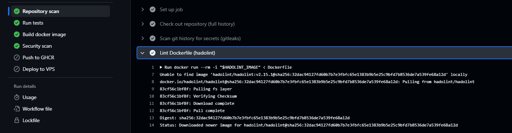](https://github.com/Kallai-st/cicd-sg/blob/main/docs/images/10-hadolint-ci-passed.png)

   *After the fix the lint step reports nothing.*

9. Required checks

   [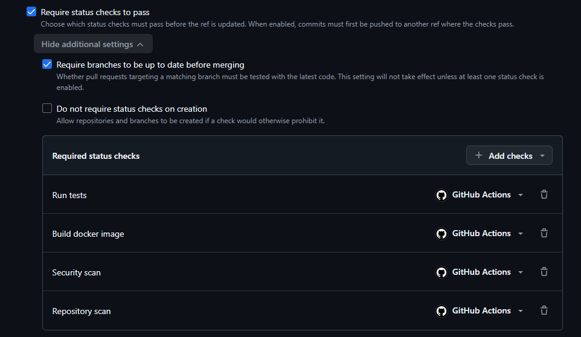](https://github.com/Kallai-st/cicd-sg/blob/main/docs/images/10-ruleset-required-checks.png)

   *`Repository scan` added to the required status checks of the branch ruleset.*

10. gitleaks on a clean history

    [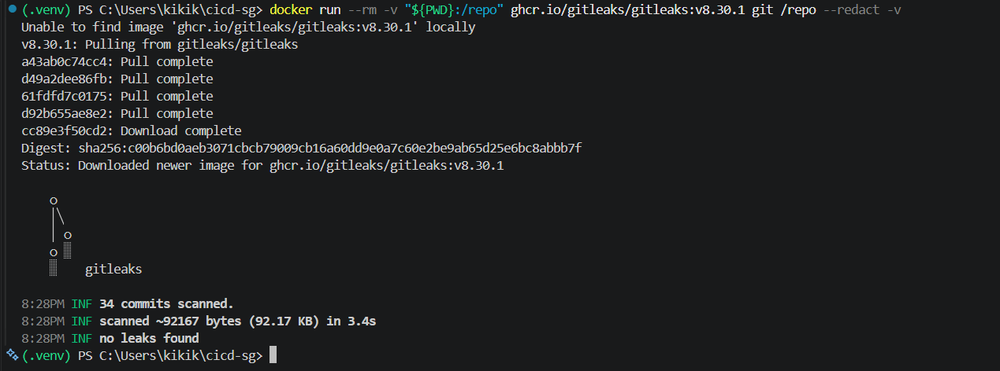](https://github.com/Kallai-st/cicd-sg/blob/main/docs/images/10-gitleaks-clean.png)

    *34 commits scanned, no leaks found.*

11. gitleaks finds the fake key (local)

    [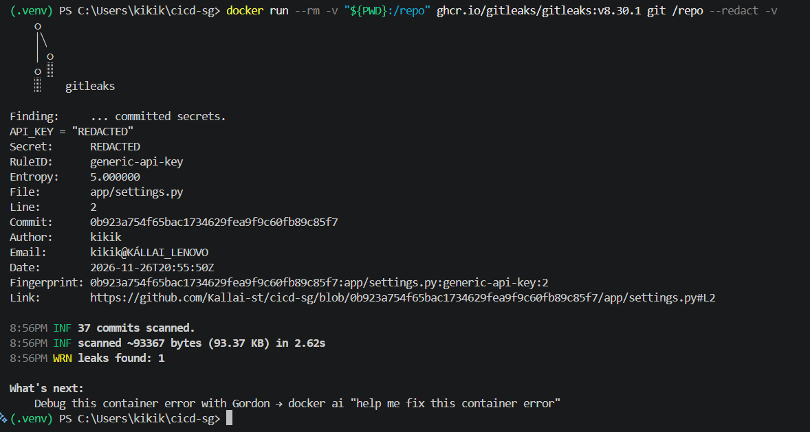](https://github.com/Kallai-st/cicd-sg/blob/main/docs/images/10-gitleaks-local-leak.png)

    *The finding shows the rule, file, line and commit; the value itself is redacted.*

12. gitleaks gate in CI

    [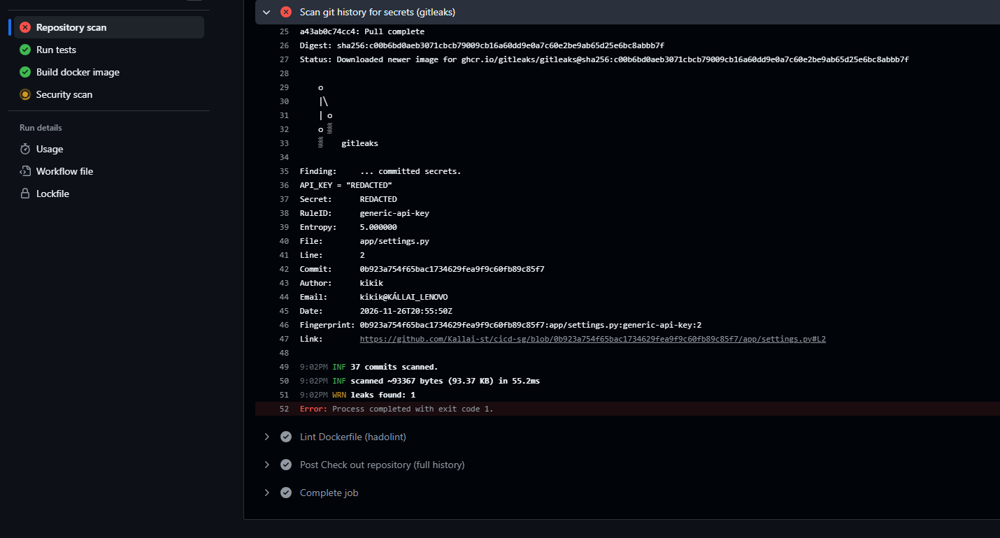](https://github.com/Kallai-st/cicd-sg/blob/main/docs/images/10-gitleaks-ci-failed.png)

    *The repository scan fails on the committed secret.*

13. Merge blocked

    [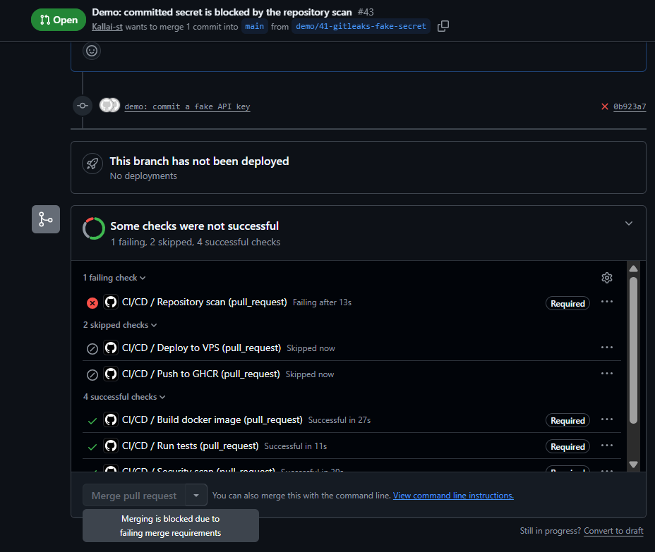](https://github.com/Kallai-st/cicd-sg/blob/main/docs/images/10-gitleaks-pr-blocked.png)

    *`Repository scan` is required, so pull request #43 cannot be merged even though every other check passed.*

## Limitations

- **Only top-level Python packages are pinned.** Transitive dependencies (for example Werkzeug, Jinja2) are still resolved at build time. A full lock file (for example with `pip-tools` and hashes) would make builds fully reproducible.
- **The base image is not managed by Dependabot.** `python:3.12-slim` is pinned by tag, not by digest, and Dependabot would propose moving to a newer Python minor version rather than picking up patch-level fixes. The `apt-get upgrade` layer and a scheduled rebuild without cache are the intended way to pick up base image fixes.
- **GitHub's own actions are pinned by tag.** `actions/*` (checkout, setup-python, upload-artifact, …) and the Docker actions are pinned to major tags; only third-party actions and the scanner images are pinned to a digest or SHA. Pinning everything to SHAs would be stricter, and Dependabot would keep those SHAs up to date as well.
- **Dependabot updates are not automatic.** Updates are proposed weekly and merged by hand; nothing is merged automatically, which is intentional but means updates can wait.
- **The scanner images themselves are not updated by Dependabot.** The gitleaks and hadolint images are referenced in a `run:` command, which Dependabot does not read. Their version and digest have to be updated manually.
- **gitleaks is pattern-based.** It finds secrets that match known formats or look random enough next to a keyword. A low-entropy password or an unusual format can still slip through, and false positives are possible.
- **A found secret is already exposed.** The scan blocks the merge, but the commit has already reached GitHub (the fake key from the demo is still reachable through the closed pull request). For a real secret, deleting the commit is not enough: it must be revoked and replaced immediately.
- **hadolint only covers the Dockerfile.** The Compose file and the workflow file are not linted by this job.
